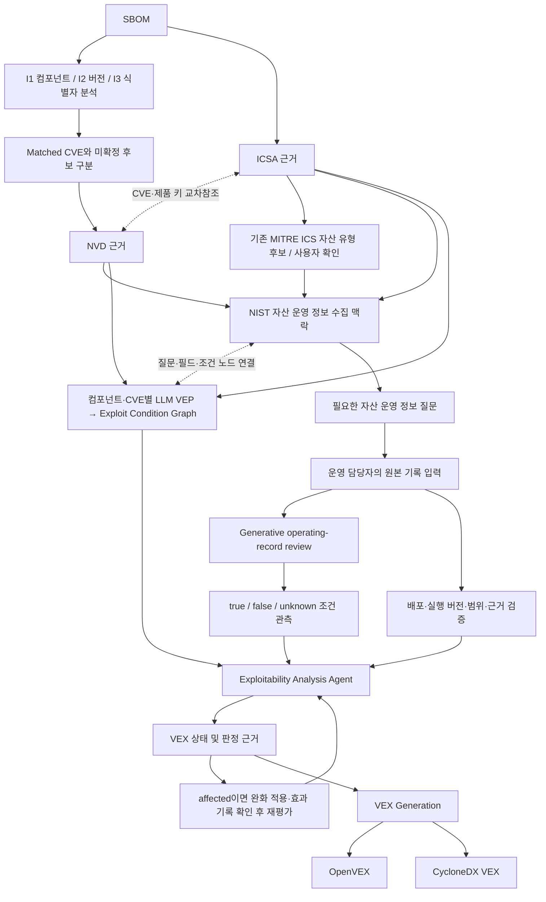

# BOM부터 VEX까지의 실행 흐름

2026-11-19 LLM VEP 및 NLI 제거 반영. 상세 계약은 [VEP 실행 명세](VULNERABILITY_EXPLOITATION_PREREQUISITE.md)를 따른다. 기존 #3 식별 알고리즘과 ICSA 자산 분류 자료는 유지한다.

## 실행 계약

- 원본 BOM 업로드: `POST /api/bom-vex/start`가 기존 `candidate_web.submit`을 unified/local 설정으로 호출한다. 진행 조회 후 `from-job`으로 불변 BOM·컴포넌트 참조를 인계한다. 재접속은 URL의 `identification_job`으로 이어간다. 기존 `from-json`은 완료된 결과·선언된 인벤토리를 가져오는 별도 호환 API로 유지한다.
- `component_operational_workflow.py`: ICSA/NVD 원문 식별자·해시·제품 키, 기존 분류의 추정 상태와 제품별 연결 범위를 보존한다. 다른 제품의 분류를 실제 컴포넌트의 분류 근거로 승격하지 않는다. 실제 자산 유형은 사용자가 확인한다.
- 자산 유형은 공통 수집 주제와 유형별 수집 맥락을 제공한다. CVE 근거가 요구하는 조건을 생략하거나 사실값을 만들지 않는다. NIST SP 800-82r4 IPD Appendix C Tables 12–17의 54개 원천 행, 167개 프로젝트 파생 수집 세부항목 중 조건에 대응하는 필드를 질문한다. NIST 자체가 CVE별 악용 전제를 정의하는 것은 아니다.
- 계획의 `workflow_contract.query_graph_links`가 질문 → NIST 필드·원문 → 그래프 조건 노드를 연결한다. 이 계약도 `plan_sha256`에 포함되므로 근거·범위가 바뀌면 질문을 재생성해야 한다.
- `nist_attack_graph.py`: 조건 노드, AND/OR/NOT 게이트, CVE 악용 목표로 구성한 DAG를 답변 전에 만든다. 간선은 필요조건 관계다. 하나의 간선이 완전한 공격 경로를 뜻하지 않으며 AND의 모든 입력을 충족해야 한다. 전제조건과 논리 관계는 LLM VEP에서 가져오고 MulVAL/XSB가 그래프를 생성한다.
- `vulnerability_exploitation_prerequisite.py`: 생성형 LLM의 VEP 조건·제품 범위·논리식·원문 인용을 검사한다. 추출 실패 시 정규식 또는 NLI overlay로 대체하지 않는다.
- `operational_record_llm.py`: 동일 범위의 원본 운영 기록을 생성형 LLM으로 대조한다. 모든 선택 기록의 현재 적용 상태가 같은 참/거짓을 지지해야 확정하며 부정은 완전한 범위 근거가 필요하다. 누락·충돌·실패는 unknown이다. NLI 모델과 점수 임계값은 사용하지 않는다.
- `exploitability_analysis.py`: LLM 운영 기록 대조와 구조화 관측으로 얻은 3값 사실만 받아 그래프와 완화 후 그래프를 평가한다. 언어 모델이 최종 VEX 상태를 직접 쓰지 않는다.
- 두 내보내기는 같은 저장된 평가를 재검증한다. OpenVEX의 `fixed`는 CycloneDX의 `resolved`에 대응한다. `resolution_basis`로 실행 버전 수정과 검증된 경로 차단을 구분한다.

## 상태

| 상태 | 판정 |
| --- | --- |
| `affected` | 검증된 배포·취약 버전과 운영조건에서 경로 발견. 완화가 미적용·미검증·불완전하면 유지 |
| `not_affected` | 검증된 미배포 또는 공급사가 명시한 비영향 버전. 운영상 경로 차단만으로 제품 비영향을 판단하지 않음 |
| `fixed` | 관측된 실행 버전이 공급사 수정 기준을 충족. 외부 운영 통제와 분리 |
| `under_investigation` | 자산 운영 정보 어댑터 없음, 필수 입력·제품 연결 미확정, LLM 대조 보류·실패·충돌, 또는 불완전한 그래프로 비영향 입증 불가 |

`product_applicability`, `prerequisite_status`, `deployment_exploitability`, `product_vex_status`를 별도 산출한다. 조건 충족과 현재 배포에서의 알려진 경로 상태를 구분하고, 경로가 차단돼도 제품 VEX 상태를 자동 변경하지 않는다. 두 역할 어댑터의 데이터·학습·평가는 [현재 학습 문서](PREREQUISITE_ROLE_TRAINING_DATA.md)에 기록한다.

과거 NLI 실행 코드는 전용 실행기와 함께 제거했다. 기존 평가셋과 결과는 수정 전 정책의 연구 이력이다. 회귀 테스트 통과와 합성 정답 일치도는 실제 운영 기록의 독립적인 의미 정확도 평가가 아니다.
