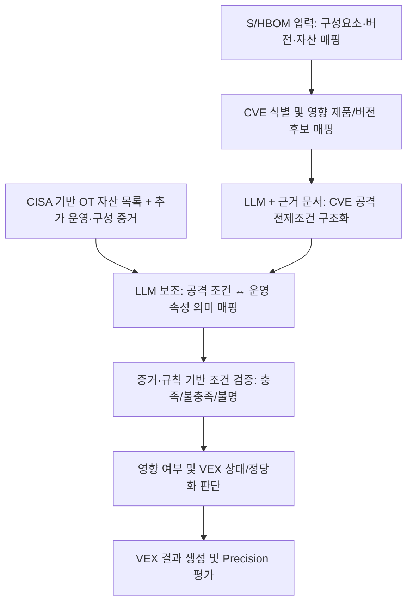

# S/HBOM 및 OT 운영 맥락 기반 LLM 보조 VEX 판단 연구

> **문서 상태:** 연구 설계 초안 (2026-10-27 논의 내용 정리)  
> **주의:** 아래 OC 분류와 처리 규칙은 연구용 *제안*이며 CISA가 정의한 표준 모델이나 실험으로 검증된 결과가 아니다.

## 1. 연구 목적

S/HBOM(Software/Hardware Bill of Materials)을 입력으로 자산의 구성요소 및 잠재적인 CVE를 식별한 뒤, **개별 자산의 실제 OT 운영 맥락을 이용해 CVE의 공격 전제조건이 충족되는지 검토**하고 근거를 갖춘 VEX 판단 결과를 생성한다.

- **평가 단위:** `(자산, CVE, 운영 상태)` 조합. 같은 CVE라도 배포 환경에 따라 판단 근거가 다르다.
- **핵심 연구 문제:** CVE 서술에 포함된 공격 전제조건을 실제 OT 운영 정보에 어떻게 대응·검증할 것인가?
- **성능 목표:** 사용자 제시 정의에 따른 **Precision > 90%**. Recall/F1은 필수 목표에 포함하지 않는다.
- **개념 구분:** ① 구성요소의 취약점 영향 여부 ② 특정 운영 환경의 공격 조건 충족 여부 ③ 공식 VEX 상태는 동의어가 아니다.

## 2. 제안 워크플로

### LLM을 배치하는 위치

1. **공격 전제조건 추출:** CVE 설명, 제조사 보안 권고문 등의 비정형 텍스트에서 요구 기능·설정·권한·접근 경로를 구조화한다. 조건별 원문 근거를 함께 보관한다.
2. **조건-운영 맥락 의미 매핑:** 추출 조건을 확인할 자산 속성, 장비 설정 및 증거 자료에 연결한다.
3. **최종 판정은 검증 가능한 규칙·증거로 수행:** LLM의 단독 직감 판정을 최종 정답으로 사용하지 않는다. 출력 문서의 문장화에는 LLM을 보조적으로 사용할 수 있다.

## 3. 주된 근거 자료와 한계

| 자료 | 연구에서의 역할 | 직접 제공하지 않는 것 |
|---|---|---|
| CISA 외 공동기관 (2025), *Foundations for OT Cybersecurity: Asset Inventory Guidance for Owners and Operators*, Appendix A, Table 1 (pp. 15–18) | OT 자산 속성 **32개**, 수집 우선순위 및 기대 효과 | CVE별 공격 조건·VEX 자동 결정 규칙 |
| 동일 문서 pp. 8–11 | 자산 수집, OT Taxonomy, Zone/Conduit, 통신·공정 의존성 조사 | 개별 현장의 실제 접근 가능성 측정값 |
| FIRST, *CVSS v4.0 Specification Document* | 공격 벡터(AV), 권한 요구(PR), 공격 요구조건(AT) 등 개념 참고 | 특정 자산의 실제 설정과 도달성 |
| CISA의 VEX 상태 정당화 관련 자료 및 선택한 VEX 규격 | VEX 상태와 `not_affected` 정당화의 의미 검토 | 모든 OT 악용 전제조건의 표준 분류체계 |

- CISA Appendix A의 High/Medium/Low는 **자산 속성 수집 우선순위**이지 VEX 평가 중요도 순위가 아니다.
- Appendix A는 수집할 *필드와 이점*을 제시하며 필드의 상세한 기계 판독 스키마, 수집 방법, CVE별 판정 임계값을 확정하지 않는다.
- Appendix A 개수는 **High 14개 + Medium 8개 + Low 10개 = 총 32개**이다. 이전 대화의 '29개'는 잘못된 집계였다.

원문: https://www.cisa.gov/sites/default/files/2025-08/joint-guide-foundations-for-OT-cybersecurity-asset-inventory-guidance_508c.pdf  
CVSS: https://www.first.org/cvss/v4.0/specification-document

## 4. CISA Appendix A 32개 필드의 연구용 분류

아래 구분은 연구용 **초안**이다. 필드를 자산 DB에서 삭제한다는 의미가 아니라 **악용 조건 판단 시 기본 사용 여부**를 의미한다.

### 4.1 핵심 판단 후보 10개 — 유지·세분화

| CISA 원문 | 제안 파생/정규화 속성 | 분석 용도 |
|---|---|---|
| Manufacturer | `vendor_id` | 영향 제품 식별 |
| Model | `product_id` | 영향 제품 식별 |
| Operating System | `os_name` | OS 조건 확인 |
| Firmware/Software Version | `firmware_version`, `component_version` | 취약 버전 확인 |
| OS Version | `os_version` | 취약 OS 버전 확인 |
| Active/Supported Communication Protocols | `supported_protocols`, `active_protocols` | 지원과 실제 사용 구분 |
| Ports/Services | `listening_ports`, `running_services`, `service_enabled` | 취약 서비스 사용 상태 |
| IP Address | `network_interfaces`, `ip_addresses` | 자산 네트워크 식별 |
| VLAN | `vlan_id`, `network_zone` | 네트워크 배치 확인 |
| User Accounts | `authentication_enabled`, `anonymous_access_allowed`, `effective_privileges` | 해당 취약 기능의 인증·권한 조건 확인 |

**중복 수집 최소화:** S/HBOM과 CVE 매핑 단계에서 제조사·제품·버전이 신뢰성 있게 확보되면, 해당 데이터를 운영 맥락에서 다시 요구하지 않고 연결한다.

### 4.2 조건부 보조 7개

| CISA 원문 | 조건부 활용 |
|---|---|
| Asset Role/Type | 실제 역할 및 사용 기능 확인 |
| Physical or Virtual | 배포 형태 의존 취약점 |
| Hypervisor (if applicable) | 가상화 관련 취약점 |
| Primary Communication Method | 유선·무선·RF 등 매체 특성 |
| Logging | 주요 목적은 탐지·조사; 필요 시 보조 증거 |
| Network Monitoring | 주요 목적은 탐지 수준 파악 |
| Antivirus (AV)/Endpoint Protection | 검증 가능한 특정 방어 통제 조건에만 사용 |

### 4.3 영향 여부와 별도인 조치 우선순위용 1개

- **Asset Criticality:** 악용 시 운영상 중요도 또는 조치 우선순위 평가에는 적합하지만, 취약점이 실제 악용 가능한지를 직접 증명하지 않는다.

### 4.4 기본 악용 판단에서 제외하는 14개

`Asset Number`, `Hostname`, `MAC Address`, `Physical Location/Address`, `Backup Frequency/Type`, `Baseline Image`, `Department/Owner`, `Distributor`, `Date of Manufacture`, `Local Time Zone`, `Location Within Hypervisor`, `Notes/Description`, `Serial Number`, `Time Source`.

- 제외는 *기본 조건 평가*에 한정하며 특수 CVE에 해당 속성이 필요하면 다시 사용한다.
- `Asset Number` 같은 식별자는 CVE 판단 조건이 아니어도 자산–S/HBOM–VEX 연결에 중요하므로 **데이터 키로 유지**한다.
- 위 10+7+1+14 = **32개**.

## 5. OT 운영 맥락(OC) 모델: 초기 6개와 수정 제안 5개

### 5.1 최초의 OC1~OC6 (연구자가 제안한 분류, 표준 아님)

| ID | 최초 범주 | 근거 및 추가 가정 |
|---|---|---|
| OC1 | 취약 기능 활성 상태 | CISA Asset Role/Type 간접 + 실제 기능 활성 정보 추가 필요 |
| OC2 | 취약 서비스 실행 상태 | CISA Ports/Services에서 서비스 실행 상태로 확장 |
| OC3 | 통신 프로토콜 사용 상태 | CISA Active/Supported Communication Protocols 직접 대응 |
| OC4 | 네트워크 접근 가능 상태 | CISA IP/VLAN 및 Zone/Conduit에 네트워크 정책·경로 검증 추가 |
| OC5 | 인증 및 접근 권한 상태 | CISA User Accounts 간접 + CVSS PR 개념 참고 |
| OC6 | 취약점 관련 구성 상태 | CISA 일부 환경 필드 + CVSS AT 및 CVE의 구체 조건 참고 |

### 5.2 더 간결한 최종 설계 **후보** 5개

OC1과 OC2의 중복, 기존 OC6의 범위가 지나치게 넓다는 문제를 고려한 수정안이다. **아직 최종 확정하거나 사례 검증한 모델은 아니다.**

| ID | 제안 명칭 | 확인할 정보 |
|---|---|---|
| OC1 | 취약 기능 및 코드 실행 상태 | 관련 기능·서비스 활성, 취약 코드 경로의 실행 가능성 |
| OC2 | 통신 프로토콜 사용 상태 | 실제 활성 프로토콜과 CVE 요구조건 일치 여부 |
| OC3 | 공격 경로 접근 가능 상태 | 가정한 공격 위치에서 서비스/기능까지의 경로 및 통제 |
| OC4 | 인증 및 권한 조건 | 인증 요구, 익명 접근, 실제 접근 주체 권한 |
| OC5 | 취약점별 구성 및 실행 전제조건 | 특정 설정, 배포 형태, 실행 환경 등 |

> **검증 필요:** AV, PR, AT 이외에도 CVSS의 Attack Complexity, User Interaction 등의 조건이나 CVE별 예외가 포함될 수 있다. 대표 OT CVE로 실제 포괄률을 확인해야 한다.

### User Accounts 확장 필드의 한국어 정의

| 영문 | 한글 | 정의 |
|---|---|---|
| `authentication_enabled` | 인증 기능 활성 여부 | **취약한 서비스/기능**에 접근할 때 사용자 인증을 요구하는지 여부 |
| `anonymous_access_allowed` | 비인증 접근 허용 여부 | **취약한 서비스/기능**에 인증 없이 접근할 수 있도록 허용하는지 여부 |
| `effective_privileges` | 실효 접근 권한 수준 | 해당 접근 주체가 실제 행사할 수 있는 권한 수준 |

이 값들은 자산 전체에 대해 일괄 지정하지 않고 가능한 한 **해당 CVE와 관련된 기능·서비스 단위**로 기록한다. CVE가 요구하는 권한과 실제 자산의 계정 권한도 서로 다른 데이터로 저장한다.

## 6. 공격 전제조건과 운영 정보의 비교 예시

가상의 CVE가 '웹 관리 기능 활성 + 인증 없는 접근 + 네트워크 접근 가능'을 요구한다고 가정한다.

| CVE에서 요구하는 조건 | 운영 맥락의 증거 | 판정 |
|---|---|---|
| 웹 관리 기능 활성 | 장비 설정값·실행 상태 | 충족/불충족/불명 |
| 인증 불필요 | 해당 기능 인증 설정 및 접근 검사 | 충족/불충족/불명 |
| 네트워크 접근 가능 | 공격자 위치, 방화벽/라우팅, Zone/Conduit | 충족/불충족/불명 |

- 지원 프로토콜과 **활성** 프로토콜, 열린 포트와 **취약 코드 실행 가능성**, VLAN 위치와 **실제 공격 경로**는 구분한다.
- 값이 없으면 `false`로 간주하지 않고 **unknown**으로 처리한다.
- 임의의 조건 불충족이나 차단 통제가 자동으로 VEX `not_affected`를 의미하지는 않는다. 선택한 VEX 규격의 상태·정당화 의미를 확인해야 한다.

## 7. VEX 판단과 판정 유보

검증 결과에 근거해 VEX 상태(예: `affected`, `not_affected`, `under_investigation`, `fixed`)를 생성한다. 다만 이것들은 운영 맥락상의 단순한 '공격 가능/불가능' 레이블과 일대일 대응하지 않는다.

- 영향이 있다는 근거가 확인되면 선택한 VEX 형식의 기준에 따라 `affected`를 검토한다.
- `not_affected`는 해당 형식이 인정하는 정당화 및 증거가 확보된 경우에만 사용한다.
- 정보 부족·불확실성은 `under_investigation` 등으로 표현한다.
- `fixed`는 수정·패치된 상태를 입증할 근거가 있을 때 사용한다.

## 8. 유일한 필수 성능 목표: Precision > 90%

사용자 제시 지표:

\[
\operatorname{Precision}(\%) = \frac{TP}{TP+FP}\times100
\]

- **Positive 정의:** `affected`로 예측한 자산–CVE 사례.
- **TP:** 실제 `affected`인 사례를 `affected`로 판단.
- **FP:** 실제 `not_affected`인 사례를 `affected`로 잘못 판단.
- **성공 기준:** **Precision > 90%** (정확히 90.00%는 미충족).
- `TP + FP = 0`이면 Precision은 계산할 수 없으며 목표 달성으로 간주하지 않는다.
- 유보한 사례는 위 이진 Precision의 분자·분모에 들어가지 않는다. 유보 사례와 전체 시험 건수는 평가 결과의 맥락으로 투명하게 보고한다.
- 실제 정답(Ground Truth)은 제조사 VEX/보안 권고, 장비 설정 검증, 재현 가능한 실험 또는 전문가 확인 등 독립된 근거로 구축한다.

**범위에 관한 결정사항:** Recall, F1-score, Accuracy 등은 이번 연구의 **필수 성능 합격 조건이 아니다.** 논문에서 추가 보고할지는 별도 결정한다.

### 비교 실험 후보

| 실험 | 구동 방식 | 목적 |
|---|---|---|
| M1: BOM+CVE Baseline | 구성요소 취약점 매칭을 잠정 영향으로 간주 | 운영 맥락 도입 전 기준선 |
| M2: Rule-based | 운영 맥락 + 수작업 정의 규칙 | LLM 없는 조건 판단 |
| M3: LLM-only | LLM에 CVE 및 자산 정보를 주고 직접 판정 | 직접 생성 방식 비교 |
| M4: Proposed | LLM 조건 추출/매핑 + 검증 규칙 + VEX 출력 | 제안 방식의 Precision 검증 |

모두 **같은 평가 사례**, 일관된 Positive 기준 및 독립 Ground Truth로 비교해야 한다. 모델·프롬프트/규칙 개발 사례와 최종 시험 사례는 분리한다.

## 9. 남은 설계·검증 항목

- [ ] 사용할 S/HBOM 형식과 자산–구성요소 연결 방식 결정
- [ ] 사용할 VEX 형식(CycloneDX VEX, CSAF VEX, OpenVEX 등)과 상태 의미 고정
- [ ] 대표 OT CVE 샘플 선정 및 공격 전제조건 정답 데이터 구축
- [ ] 최초 OC 6개 vs 수정 OC 5개 중 모델 선정 및 커버리지 검증
- [ ] CISA 필드에서 파생된 항목별 데이터 출처, 측정·검증 방법 정의
- [ ] 충족/불충족/불명의 판정 규칙과 VEX 상태 매핑 정립
- [ ] 근거 링크·문서 구간·검증 시점·불확실성 추적
- [ ] 실험 M1~M4 수행 및 Precision > 90% 여부 확인
- [ ] 판정 유보 사례를 포함한 시험 대상 총수 보고

## 10. 현재까지의 핵심 결론

**S/HBOM은 '무엇이 포함되어 있고 어떤 CVE 후보가 있는가'를 알려주고, CISA 기반 OT 운영 정보는 '이 자산에서 공격 조건을 확인할 증거가 무엇인가'를 제공한다. LLM은 두 정보를 연결하는 비정형 조건 추출·의미 매핑에 사용하고, 최종 VEX 판단은 추적 가능한 증거와 규칙으로 수행한다.**

이는 연구 설계 제안으로, **아직 Precision 90% 초과가 실증된 상태는 아니다.**
