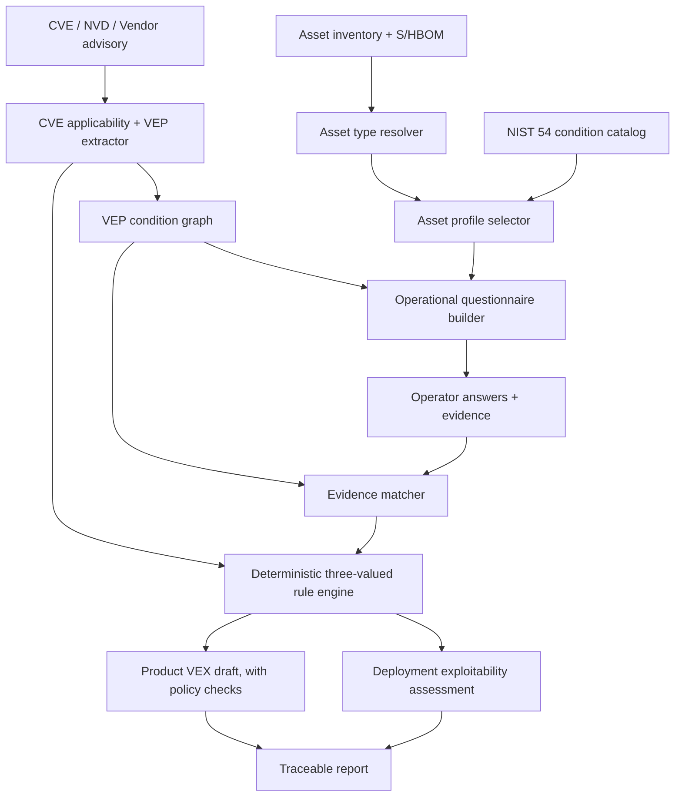

# ICS/OT 자산 유형 기반 CVE 악용 선행조건(VEP) 평가 시스템

> **Codex 구현 명세 / 연구용 프로토타입**  
> 범위: S/HBOM 및 CVE 기술정보 → 자산 유형 식별 → VEP 추출 → OT 운영정보 수집 → 공격 경로 조건 평가 → 배포환경 악용 가능성 평가 및 VEX 초안 생성  
> 상태: **설계 문서**. 본 문서에 기술한 매핑·스키마·판정 규칙은 연구 제안이며, MITRE/NIST/FIRST가 그대로 제공하는 통합 모델이 아니다.

## 0. Codex에게 전달하는 작업 지시

이 README를 **구현 요구사항의 단일 진입점**으로 사용한다. 임의의 CVE 정보, 제품 영향 버전, 공격 경로, 자산 운영 정보 또는 출처를 지어내지 않는다. 실제 근거가 없거나 조건 도출이 불분명하면 `unknown`으로 보존한다. LLM은 **추출·분류·질문 생성**에 사용하고, 최종 논리 평가는 **결정론적 규칙 엔진**이 수행한다.

**1차 구현 목표(MVP)**

1. JSON 기반 자산 및 S/HBOM 입력(샘플 입력부터 시작)
2. CVE/제조사 권고문을 근거로 한 VEP 조건 구조화(처음에는 수동 JSON 입력 + 선택적 LLM 어댑터)
3. 18개 자산 유형 분류와 자산별 자산 운영 정보 질문 추천
4. NIST 54개 항목을 추적 가능한 분류 참조로 관리
5. 세 값 논리(`satisfied`, `unsatisfied`, `unknown`)와 AND/OR 공격 경로 평가
6. 제품 영향 상태와 배포환경 악용 가능성을 **별도 산출**
7. VEX 상태 초안 및 판단 근거 생성(표준 정합성 검증 없는 자동 `not_affected` 금지)
8. 단위 테스트, 예시 입력/출력, 실행 명령, API 문서 제공

**범위 밖(초기 버전)**: 실제 PoC 공격 실행, 실시간 OT 장비 스캔, PLC 제어, 펌웨어 역공학, 소스코드 기반 도달성 증명, 운영환경의 증거 없는 자동 판단. 모든 장비 접근은 읽기 전용·오프라인 자료 우선.

---

## 1. 문제 정의와 목적

기존 CVE 매칭만으로는 ICS/OT 자산의 **실제 배포환경에서 악용 선행조건이 충족되는지**를 알 수 없다. S/HBOM에 나타난 소프트웨어/펌웨어, 공인 CVE 자료, 제조사 권고문과 운영자가 제공하는 설정·네트워크·권한 정보를 결합해 다음을 수행한다.

- **제품 영향성(Applicability)**: 해당 제품/버전/구성요소가 CVE 영향 범위에 포함되는가?
- **선행조건 충족성(Prerequisite Satisfaction)**: 구체적인 공격 경로를 구성하는 필수 조건이 실제 자산에서 충족되는가?
- **배포환경 악용 가능성(Deployment Exploitability)**: 알려진 공격 경로의 조건 평가 결과는 무엇인가?
- **VEX 문서화(Product VEX)**: 위 평가를 바탕으로 표준의 의미와 정당화 기준에 부합하는 경우에만 VEX 초안을 만든다.

> **중요한 구분**: `deployment_exploitability=not_reachable` 등은 곧바로 표준 VEX `not_affected`를 뜻하지 않는다. 제품 자체가 영향을 받는지와 현장 접근 가능성은 서로 다른 차원이다. 악용 조건 충족은 실제 익스플로잇 성공의 증명도 아니다.

### 규범적/참조 자료의 역할

| 자료 | 시스템에서의 역할 | 사용상 주의 |
|---|---|---|
| MITRE ATT&CK for ICS Assets | 자산 유형과 기능·공격표면 식별에 도움 | 자산 유형이 곧 취약점 선행조건은 아님 |
| NIST SP 800-82 Rev.4 **IPD (2026-09)** Appendix C.2.2, Tables 12–17 | OT의 취약성 유발 조건과 자산 운영 정보 수집 항목의 추적 기준 | 초안 문서; 54개 조건은 CVE별 필수 조건 목록이 아님 |
| FIRST CVSS v4.0 | 공격 벡터·요구 권한·사용자 상호작용·Attack Requirements 등의 개념적 참조 | CVSS 벡터만으로 모든 개별 CVE의 VEP를 복원할 수 없음 |
| NVD/CVE Record/제조사 보안 권고문 | CVE 영향 제품·버전 및 실제 공격 선행조건의 **직접 근거** | 출처 우선순위 및 상충 여부 기록 |
| CycloneDX/SPDX S/HBOM | 제품·패키지·버전·구성요소 식별 입력 | 패키지명이 취약 제품임을 자동으로 보장하지 않음 |
| CSAF VEX 또는 OpenVEX | VEX 상태의 표준 포맷 출력 후보 | 선택한 스키마에 따른 필수 속성과 justification 검증 필요 |

공식 참고 링크:

- MITRE: https://attack.mitre.org/assets/
- NIST: https://doi.org/10.6028/NIST.SP.800-82r4.ipd
- CVSS v4.0: https://www.first.org/cvss/v4.0/specification-document
- NVD: https://nvd.nist.gov/
- CVE: https://www.cve.org/
- CSAF: https://oasis-open.github.io/csaf-documentation/
- OpenVEX: https://openvex.dev/

이 문서는 참고 링크를 명시하되 사이트의 현재 버전·세부 URL 및 저작권 조건은 구현 시 재확인한다.

---

## 2. 용어 정의와 모델 범위

**VEP(Vulnerability Exploitation Prerequisite)**: 특정 CVE가 특정 자산에서 특정 공격 시나리오를 통해 악용되기 위해 필요한 **기술적·환경적 선행조건**의 구조화된 표현. 본 프로젝트에서 정의한 연구용 모델이다.

CVE `c`, 자산 `a`, 공격 시나리오 `s`, 평가 시점 `t`에 대해:

```text
VEP(c, a, s, t) = (P, Φ, E, σ)

P: 개별 선행조건 집합
Φ: 선행조건 사이의 AND/OR 논리식 (공격 경로)
E: 관측된 자산 운영 정보와 확인 가능한 증거
σ: 각 조건의 평가 상태 (satisfied/unsatisfied/unknown)
```

한 개별 조건의 최소 정의:

```text
p_i = (condition_id, category, predicate, operator, expected, source)
```

조건의 필수성/역할을 `required | alternative | contextual | unknown`으로 관리한다. `contextual` 항목은 설명·위험 분석에는 사용하지만 직접적인 AND 판정에 자동 포함하지 않는다.

### 2.1 VEP 상위 범주 (연구용 분류)

| 코드 | 영문 범주 | 의미 | 예시 검증 대상 |
|---|---|---|---|
| V1 | Product Applicability | 취약 제품/버전/구성요소의 영향성 | 제품·버전·빌드·패치 |
| V2 | Vulnerable Function Availability | 취약 기능 또는 서비스의 존재·활성 | `service_enabled`, `feature_enabled` |
| V3 | Attack Interface Availability | 공격 입력을 수용할 인터페이스 존재 | 웹 API, TCP 포트, 직렬 포트, 필드버스 |
| V4 | Attack Path Reachability | **정의된 공격 출발점에서** 대상 인터페이스로 도달 가능 | ACL, 경로, 세그먼트, VPN |
| V5 | Authentication Prerequisite | 공격에 사전 인증이 필요한지, 필요한 경우 충족 가능한지 | 무인증, 유효한 세션, 인증 우회 |
| V6 | Privilege Prerequisite | 공격 시작 전에 요구되는 계정·역할·시스템 권한 | 관리자/일반 사용자/로컬 권한 |
| V7 | Execution and Trigger Conditions | 특수 입력, 모드, 사용자 동작 등 공격 트리거 | 유지보수 모드, 파일 열기, 악성 요청 처리 |

**V1을 영향성 게이트로 우선 평가**한다. V2~V7은 CVE별로 실제 필요한 항목만 동적으로 생성한다. 예를 들어 무인증 CVE에 `authentication_enabled=false`를 보편적 필수조건으로 추가하지 않는다. `required_prior_authentication=none`은 공격 요구사항이지, 제품의 로그인 기능 설정 상태와 같은 명제가 아니다.

### 2.2 세 값 논리와 증거 원칙

- `satisfied`: 근거에 의해 선행조건이 충족됨.
- `unsatisfied`: 근거에 의해 선행조건이 **불충족됨**.
- `unknown`: 정보 부족·상충·유효기간 경과·요건 미정의.
- 사실 응답 `true/false/unknown`과 VEP 평가 상태는 **다른 층위**다. 예를 들어 `authentication_enabled=true`를 V5 `unsatisfied`로 단순 변환하지 않는다.
- 필수 조건이 아닌 경우 `not_applicable`로 관리하거나 판정식에 포함하지 않는다. `unknown`과 혼동하지 않는다.
- 공격 조건이 충족되어도 실제 악용 성공을 보장하지 않는다.
- 알려진 공격 경로가 모두 불충족이라 해도 **미확인된 별도 공격 경로가 없다는 증명은 아니다**. 결과와 신뢰 범위를 보고한다.

---

## 3. 전체 데이터 흐름 / 컴포넌트



기존 연구에서 사용한 문제 계층 L1~L5(코드 분석·제품 매핑·자산 운영 정보 등)와 구현 단계명을 혼동하지 않는다. 구현 컴포넌트는 역할 기반 이름을 사용한다.

권장 컴포넌트:

1. `asset_resolver` — 자산 데이터 정규화, MITRE Asset Type 분류 및 사용자가 수정 가능한 확인 단계
2. `cve_ingest` — CVE 레코드 및 제조사 권고문 수집/버전 고정/중복 제거
3. `applicability` — 제품·버전·구성요소 및 패치 상태 확인
4. `vep_extractor` — 근거 있는 선행조건 추출·정규화·AND/OR 관계 추출
5. `nist_catalog` — 54개 NIST 참조항목과 운영 필드 매핑
6. `questionnaire` — 자산 유형과 CVE에 따른 최소 질문 구성
7. `evidence_store` — 운영자 응답, 설정 증거, 관측 시각, 검증자 저장
8. `evaluation_engine` — 결정론적 세 값 논리와 불확실성 처리
9. `vex_exporter` — 제품 영향성과 배포환경 악용 가능성의 분리 및 VEX 초안 출력
10. `audit_report` — 각 판단에 사용된 원문과 근거 추적

---

## 4. MITRE ATT&CK for ICS: 18개 자산 유형

아래 항목들은 프로젝트의 자산 분류 **초기 레지스트리**다. 구현자는 MITRE 공식 Assets 페이지를 다시 조회하여 **정식 명칭, Asset ID, 설명, 현행 버전 및 변경 여부**를 검증해 레지스트리에 출처·조회 시각을 남긴다. MITRE 공식 명칭/ID와 불일치하는 데이터가 발견되면 정정해야 하며, 아래 표를 검증 없이 공식 원문으로 인용하지 않는다.

| 초기 ID | 자산 유형 | 한국어 용도 설명 |
|---|---|---|
| A0001 | Workstation | 운전·엔지니어링 워크스테이션 |
| A0002 | Human-Machine Interface (HMI) | 공정 감시·제어 인터페이스 |
| A0003 | Programmable Logic Controller (PLC) | 프로그램 기반 현장 제어기 |
| A0004 | Remote Terminal Unit (RTU) | 원격 감시·제어 단말 |
| A0005 | Intelligent Electronic Device (IED) | 보호·계측·제어 전자장치 |
| A0006 | Data Historian | 공정 이력 데이터 저장 시스템 |
| A0007 | Control Server | 제어 관련 서버 |
| A0008 | Application Server | OT 응용 서비스 서버 |
| A0009 | Data Gateway | 통신/데이터 변환 게이트웨이 |
| A0010 | Safety Controller | 안전 기능 담당 제어기 |
| A0011 | Virtual Private Network (VPN) Server | 원격 접속 VPN 서버 |
| A0012 | Jump Host | 관리망 중계 접속 호스트 |
| A0013 | Field I/O | 센서/액추에이터 연결 입출력 장치 |
| A0014 | Routers | 네트워크 라우터 |
| A0015 | Switch | 네트워크 스위치 |
| A0016 | Firewall | 방화벽 |
| A0017 | Distributed Control System (DCS) Controller | 분산제어시스템 제어기 |
| A0018 | Programmable Automation Controller (PAC) | 프로그래머블 자동화 제어기 |

한 자산이 복수 역할을 수행할 수 있으므로 `asset_types: []` 배열과 `primary_asset_type`을 지원한다. 모호하면 `unresolved`로 남기고 사용자 확인을 요청한다.

---

## 5. NIST Appendix C.2.2 Tables 12–17: 54개 조건 카탈로그

출처: NIST SP 800-82 Rev.4 **Initial Public Draft (September 2026)**, Appendix C.2.2. 표에 실린 원문 `Vulnerability`와 `Description`은 별도 원문 데이터 파일로 보존하고, 아래 한국어 항목명은 **연구용 요약**으로 취급한다. `C12-01` 등은 **NIST 공식 ID가 아닌 프로젝트 내부 ID**다.

| 표 | 공식 범주(영문) | 개수 |
|---|---|---:|
| 12 | Architecture and design vulnerabilities and predisposing conditions | 11 |
| 13 | Configuration and maintenance vulnerabilities and predisposing conditions | 21 |
| 14 | Physical vulnerabilities and predisposing conditions | 5 |
| 15 | Software development vulnerabilities and predisposing conditions | 3 |
| 16 | Communication and network configuration vulnerabilities and predisposing conditions | 11 |
| 17 | Sensor, final element, and asset management vulnerabilities and predisposing conditions | 3 |
| 합계 | | **54** |

### Table 12 — Architecture and design (11)

| ID | 연구용 한국어 요약 |
|---|---|
| C12-01 | 구조·설계에 보안 요구사항 반영 부족 |
| C12-02 | 안전하지 않은 변경·구조 관리 |
| C12-03 | 보안 경계 정의 부족 |
| C12-04 | 제어망과 비제어 트래픽 혼재 |
| C12-05 | 비제어망 서비스 의존 |
| C12-06 | 이벤트 이력 수집·유지 부족 |
| C12-07 | IoT/IIoT 통합 보안 설계 부족 |
| C12-08 | 클라우드 연결 보안 설계 부족 |
| C12-09 | 암호기술 전환·변경 준비 부족 |
| C12-10 | AI 통합의 보안 고려 부족 |
| C12-11 | AI 확률적 동작 특성 고려 부족 |

### Table 13 — Configuration and maintenance (21)

| ID | 연구용 한국어 요약 |
|---|---|
| C13-01 | 자산 관리 미흡 |
| C13-02 | 설정 관리 미흡 |
| C13-03 | 보안 패치 제공 지연 |
| C13-04 | 공급업체 패치 지원 부족 |
| C13-05 | 취약점 관리 미흡 |
| C13-06 | 보안 변경 사전 시험 부족 |
| C13-07 | 원격 접근 통제 미흡 |
| C13-08 | 포트·프로토콜·기능 설정 미흡 |
| C13-09 | 중요 설정의 저장·백업 관리 미흡 |
| C13-10 | 휴대 장치 민감정보 보호 미흡 |
| C13-11 | 기본 비밀번호 사용 |
| C13-12 | 비밀번호 정책 준수 미흡 |
| C13-13 | 접근 권한 설정 부적절 |
| C13-14 | 외부 데이터 연결 통제 부족 |
| C13-15 | 악성코드 보호 부족 |
| C13-16 | 악성코드 보호 시험 부족 |
| C13-17 | 서비스 거부 공격에 대한 취약성 |
| C13-18 | 침입 탐지·방지 부족 |
| C13-19 | 로그 유지·관리 부족 |
| C13-20 | IoT/IIoT 설정 관리 미흡 |
| C13-21 | OT 클라우드 서비스 통제 부족 |

### Table 14 — Physical (5)

| ID | 연구용 한국어 요약 |
|---|---|
| C14-01 | 장치 물리적 접근 통제 미흡 |
| C14-02 | 전자기 간섭·전원 변동 보호 부족 |
| C14-03 | 백업 전원 부족 |
| C14-04 | 온도·습도 등 환경 조건 관리 부족 |
| C14-05 | 물리적 포트 보호 미흡 |

### Table 15 — Software development (3)

| ID | 연구용 한국어 요약 |
|---|---|
| C15-01 | 입력·수신 데이터 검증 부족 |
| C15-02 | 소프트웨어 보안 기능 활성화 부족 |
| C15-03 | 인증·권한·접근통제 기능 부족 |

### Table 16 — Communication and network configuration (11)

| ID | 연구용 한국어 요약 |
|---|---|
| C16-01 | 데이터 흐름 통제 부족 |
| C16-02 | 방화벽 설치·설정 미흡 |
| C16-03 | 방화벽·라우터 로그 관리 미흡 |
| C16-04 | 평문 통신 |
| C16-05 | 사용자·데이터·장치 인증 부족 |
| C16-06 | OT 프로토콜 보안 기능 부족 |
| C16-07 | 통신 무결성 보호 부족 |
| C16-08 | 무선 상호 인증 부족 |
| C16-09 | 무선 데이터 보호 부족 |
| C16-10 | OT·클라우드 통신 보호 부족 |
| C16-11 | 제3자 통신 의존 |

### Table 17 — Sensor, final element, and asset management (3)

| ID | 연구용 한국어 요약 |
|---|---|
| C17-01 | 센서·최종 제어요소 물리적 접근 통제 부족 |
| C17-02 | 센서·최종 제어요소 무선 설정 보안 부족 |
| C17-03 | 자산 관리 시스템 분리·변경 능력 부족 |

### 5.1 NIST 조건의 연구용 역할 태그

NIST 항목은 CVE별 필수 선행조건과 일치하지 않는다. 역할을 다음처럼 **다중 태그**로 관리한다.

- `P` (prerequisite candidate): 직접적인 악용 선행조건의 후보
- `R` (reachability): 네트워크/물리 접근 경로와 연관
- `S` (security control): 접근통제·인증·권한 등 보안 통제
- `B` (background): 배경 취약성·운영 관리 요인
- `I` (impact/resilience): 영향·복원력 관련 요인

예: `C13-08 -> [P, R]`, `C16-01 -> [R, S]`, `C14-03 -> [I]`, `C13-19 -> [B]`. **이 태그와 VEP 연결은 연구 가설**이므로 모든 매핑에 `rationale`과 `review_status`를 저장한다.

---

## 6. 18개 Asset Type별 초기 질문 프로파일

다음 표는 **선택 우선순위**이지, NIST가 제공하는 18×54 공식 매핑이 아니다. 개별 CVE의 기술적 조건에 따라 질문을 추가/제외한다.

| Asset Type | 우선 NIST 참조 | 주요 자산 운영 정보 |
|---|---|---|
| Workstation | C13-07/08/11/13, C16-05 | 원격 접근, 계정, 활성 서비스, 권한 |
| HMI | C13-07/08/13, C16-01/05 | HMI 접속·제어 기능·인증 |
| PLC | C13-08, C15-02, C16-01/05/06 | 제어 서비스, 프로토콜, 운전 모드 |
| RTU | C13-08, C16-01/05/06/11 | 원격 통신, SCADA 접근 경로 |
| IED | C13-08, C14-05, C16-05/06/07 | 보호·계측 기능, 인터페이스, 인증 |
| Data Historian | C13-07/08/13, C16-01/05 | 데이터 수집/조회 API, DB 권한 |
| Control Server | C13-07/08/13, C16-01/05 | 제어 서비스, 인증·권한, 통신 대상 |
| Application Server | C13-08/13, C15-01, C16-05 | API, 입력 처리, 계정 권한 |
| Data Gateway | C13-08, C16-01/04/06/07 | 망 간 통신, 프로토콜 변환 |
| Safety Controller | C13-08, C14-01/05, C16-05/06 | 안전 로직 변경 경로, 모드, 물리 접근 |
| VPN Server | C13-07/11/13, C16-05/07 | 원격 인증·터널·접근 정책 |
| Jump Host | C13-07/11/13/19, C16-05 | 세션·접근 권한·감사 |
| Field I/O | C14-01/05, C16-06, C17-01/02 | 필드 통신·물리 포트·무선 설정 |
| Routers | C13-02/07, C16-01/03/05 | 관리 접근, 라우팅, ACL |
| Switch | C13-02/08, C16-01/03/05 | VLAN, 관리 포트, 분리 정책 |
| Firewall | C13-02/07, C16-01/02/03 | 정책, 허용 경로, 관리 인터페이스 |
| DCS Controller | C13-08, C15-02, C16-01/05/06 | 공정제어 통신, 모드, 서비스 |
| PAC | C13-08, C15-02, C16-01/05/06 | 실행 프로그램, 제어 인터페이스 |

초기 자산 프로파일이 특정 VEP를 **자동으로 참/거짓 판단하지 않도록** 구현한다.

---

## 7. VEP와 NIST 자산 운영 정보의 연결

| VEP | 자산 운영 정보 예시 | NIST 참조 예시 | 주의 |
|---|---|---|---|
| V1 | vendor, product, version, firmware_version, patch_status | NIST 직접 근거만으로 불충분 | SBOM, CVE, 제조사 권고문으로 영향성 결정 |
| V2 | service_enabled, feature_enabled, remote_mgmt_enabled | C13-08, C15-02 | CVE가 실제로 요구하는 기능이어야 함 |
| V3 | api_endpoint, inbound_port, serial_interface, protocol_enabled | C13-08, C14-05, C16-06 | 인터페이스 존재와 네트워크 도달성은 다름 |
| V4 | source_zone, destination_zone, firewall_rule, vpn_path, network_segment | C12-03, C13-07, C16-01/02 | 공격 출발점 지정이 필수 |
| V5 | required_prior_auth, authentication_enabled, anonymous_access_allowed | C13-11/12, C15-03, C16-05 | 인증 우회/인증 전 공격 여부 구별 |
| V6 | required_role, effective_privileges, account_type | C13-13, C15-03 | 필요 권한과 실제 공격자 권한 구별 |
| V7 | firmware_mode, maintenance_window_only, trigger_event, user_interaction | C13-02/08, C15-01/02 | 추정 트리거를 필수 조건으로 단정 금지 |

### 최소 자산 운영 정보 레코드

```json
{
  "field_id": "OC-NET-01",
  "field_name": "management_service_reachable",
  "asset_id": "PLC-001",
  "asset_type": "A0003",
  "nist_refs": ["C16-01"],
  "vep_refs": ["V4"],
  "question": "엔지니어링 워크스테이션에서 해당 관리 서비스에 접근할 수 있습니까?",
  "observed_value": null,
  "value_state": "unknown",
  "evidence": [],
  "collected_at": null,
  "valid_until": null
}
```

운영자 질문의 응답은 `yes/no/unknown`(관측 사실)으로 받고, 규칙 엔진에서 CVE별 요구조건과 비교해 `satisfied/unsatisfied/unknown`으로 변환한다. 이전 연구에서 고려한 `likely_affected/likely_not_affected/continue` 응답 방식은 **해석 결과의 표현**일 수 있지만, 운영자에게 묻는 사실 질문의 원시 응답과 혼합하지 않는다.

### 질문 생성 순서

1. VEP 조건으로부터 **실제로 검증해야 할 사실** 추출.
2. 자산 유형과 NIST 조건 참조를 활용해 운영자에게 이해 가능한 용어로 변환.
3. 기존 자산정보/S/HBOM/정책/로그에서 답이 이미 존재하는지 확인.
4. 미확인 필수조건에 대해서만 우선 질문.
5. 운영자 응답에 `evidence_uri` 및 `collected_at`이 없으면 신뢰도를 낮추거나 `unknown`으로 보존.
6. 응답이 충돌하면 조용히 하나를 선택하지 말고 충돌을 기록.

---

## 8. VEP 추출 파이프라인

### 8.1 입력 자료 우선순위 및 근거

- CVE Record/NVD, 제조사 보안 권고문, 기술 분석 문서의 메타데이터를 별도로 저장.
- 직접적인 제품 영향성과 필수 공격 조건은 **CVE/제조사 권고문 등 CVE별 기술 근거**에서 추출한다.
- CVSS 벡터는 힌트/교차검증 용도이며 실제 환경의 상태를 대신하지 않는다.
- NIST는 **자산 운영 정보의 수집·해석 근거**, MITRE는 **자산 유형 근거**로 사용한다.

### 8.2 LLM 추출 요구사항

LLM은 다음 출력만 생성하도록 스키마를 제한한다.

- CVE 식별자, 공격 시나리오 설명, 제품 영향성 주장(출처 포함)
- `condition_id`, `vep_category`, `predicate`, `operator`, `expected`, `necessity`
- 공격 경로별 AND/OR 논리 구조
- 출처 식별자, 텍스트 span/위치, 인용(저작권 제한 준수), 근거의 직접성
- 모호한 부분과 반례/대체 경로

**가드레일**:

- `source_refs` 없는 필수조건은 승인하지 않는다.
- 근거와 추론을 분리한다: `direct_evidence | analyst_inference | unknown`.
- 임의의 포트번호, CVE 영향 버전, 사용자 역할을 보충하지 않는다.
- 공격 경로가 하나만 기술되어 있다고 해서 **그 경로만 존재한다고 단정하지 않는다**.
- 조건식에 순환참조, 비어 있는 AND/OR 그룹, 알 수 없는 predicate가 없어야 한다.
- 연구용 확인/검수 단계를 지원한다.

---

## 9. 결정론적 평가 규칙

### 9.1 Kleene 스타일 세 값 논리

```text
AND:
  any UNSATISFIED -> UNSATISFIED
  all SATISFIED -> SATISFIED
  otherwise -> UNKNOWN

OR:
  any SATISFIED -> SATISFIED
  all UNSATISFIED -> UNSATISFIED
  otherwise -> UNKNOWN
```

`NOT`은 실제 데이터의 `unknown`을 임의로 확정하지 않도록 `NOT(unknown)=unknown`으로 정의한다. 필요하지 않으면 NOT 연산은 1차 MVP에서 제외한다.

한 공격 경로 내 **필수 조건**은 AND로 결합하고, 대체 공격 경로는 OR로 결합한다. `contextual`은 논리식에서 제외한다.

### 9.2 제품 영향성 게이트

- `not_applicable` (신뢰할 수 있는 제품/버전 비교로 불일치 확인) → 제품 영향 비해당.
- `applicable` → 공격 경로의 V2~V7 평가 진행.
- `unknown` 또는 `conflicting` → VEX 결론을 자동 확정하지 않고 추가 근거 요구.

### 9.3 결과 분리 (필수)

```json
{
  "product_applicability": "applicable",
  "prerequisite_status": "unknown",
  "deployment_exploitability": "under_investigation",
  "product_vex_status": "under_investigation",
  "justification": null
}
```

권장 `deployment_exploitability` enum:

- `conditions_satisfied`: 모델링된 알려진 경로 중 하나의 모든 필수 조건이 충족.
- `known_paths_blocked`: 모델링된 알려진 모든 경로가 불충족. **미발견 경로 가능성은 별도 보고**.
- `under_investigation`: 조건/경로/증거가 불확실.
- `not_applicable`: 제품이 CVE 영향 대상이 아님이 검증됨.

`product_vex_status`는 선택한 VEX 포맷의 허용 상태값을 사용한다(예: `affected`, `not_affected`, `under_investigation`, 필요한 경우 `fixed`). **네트워크 차단만으로 `not_affected`를 자동 발급하지 않는다.** 출력 전 스키마 및 정당화 규칙 검증 필요.

### 9.4 금지해야 할 자동 추론

- `firewall_present=true` → `not_affected` **금지**.
- `authentication_enabled=true` → 무인증 CVE 악용 불가 **금지**.
- `service_disabled=true` → 다른 경로 포함 전체 CVE 비영향 **금지**.
- `NIST C13-19 로그 부족` → 악용 가능 **금지**.
- `NIST C14-03 백업 전원 부족` → CVE 선행조건 **자동 등록 금지**.
- S/HBOM 구성요소 이름 일치 → CVE 영향 확정 **금지**.

---

## 10. 예시: 가상 PLC 취약점 평가

**주의: 아래 CVE ID와 시나리오는 가상 데이터이며 실제 NVD에 조회하지 않는다.**

시나리오: PLC 펌웨어의 원격 관리 기능이 특정 악성 요청을 처리할 때 취약하다. CVE 기술 근거에서 서비스 활성화·네트워크 도달·요청 처리 조건이 필요하다고 **가정**한다. 별도 인증이 필요하지 않은 공격이라고 **가정**한다.

```json
{
  "case_id": "demo-plc-001",
  "cve_id": "CVE-EXAMPLE-001",
  "asset": {
    "asset_id": "PLC-001",
    "asset_types": ["A0003"],
    "vendor": "ExampleVendor",
    "product": "ExamplePLC",
    "firmware_version": "2.4.1"
  },
  "product_applicability": {
    "state": "applicable",
    "source_refs": ["demo-advisory-001"]
  },
  "attack_paths": [
    {
      "path_id": "AP-01",
      "logic": "AND",
      "conditions": [
        {
          "condition_id": "P-01",
          "vep_category": "V2",
          "predicate": "management_service_enabled",
          "operator": "eq",
          "expected": true,
          "observed": true,
          "status": "satisfied",
          "necessity": "required",
          "nist_refs": ["C13-08"],
          "source_refs": ["demo-advisory-001"],
          "evidence_refs": ["device-config-001"]
        },
        {
          "condition_id": "P-02",
          "vep_category": "V4",
          "predicate": "management_service_reachable_from_engineering_ws",
          "operator": "eq",
          "expected": true,
          "observed": null,
          "status": "unknown",
          "necessity": "required",
          "nist_refs": ["C16-01"],
          "source_refs": ["demo-advisory-001"],
          "evidence_refs": []
        },
        {
          "condition_id": "P-03",
          "vep_category": "V7",
          "predicate": "crafted_request_processed",
          "operator": "eq",
          "expected": true,
          "observed": null,
          "status": "unknown",
          "necessity": "required",
          "nist_refs": ["C15-01"],
          "source_refs": ["demo-advisory-001"],
          "evidence_refs": []
        }
      ]
    }
  ],
  "prerequisite_status": "unknown",
  "deployment_exploitability": "under_investigation",
  "product_vex_status": "under_investigation"
}
```

이 사례는 `satisfied AND unknown AND unknown = unknown`으로 평가한다. 기능이 활성화되어 있다고 해도 네트워크 도달 여부 및 트리거 조건이 확인되지 않았으므로 악용 가능성을 확정하지 않는다.

---

## 11. 제안 데이터 계약 (코드 구현용)

### 11.1 JSON 엔터티

`Asset`

```json
{
  "asset_id": "PLC-001",
  "asset_types": ["A0003"],
  "primary_asset_type": "A0003",
  "vendor": "ExampleVendor",
  "product": "ExamplePLC",
  "version": "2.4.1",
  "bom_refs": ["sbom-001"],
  "properties": {},
  "provenance": []
}
```

`Condition`

```json
{
  "condition_id": "P-01",
  "vep_category": "V2",
  "predicate": "management_service_enabled",
  "operator": "eq",
  "expected": true,
  "necessity": "required",
  "source_refs": ["advisory-001"],
  "nist_refs": ["C13-08"],
  "review_status": "pending"
}
```

`Evidence`

```json
{
  "evidence_id": "device-config-001",
  "asset_id": "PLC-001",
  "field_name": "management_service_enabled",
  "value": true,
  "method": "operator_verified_configuration",
  "source_uri": "internal://evidence/config-001",
  "collected_at": "2026-11-19T09:00:00+09:00",
  "valid_until": null,
  "verifier": "operator-001",
  "trust_level": "verified"
}
```

`Assessment`

```json
{
  "assessment_id": "assessment-001",
  "asset_id": "PLC-001",
  "cve_id": "CVE-EXAMPLE-001",
  "evaluated_at": "2026-11-19T10:00:00+09:00",
  "product_applicability": "applicable",
  "prerequisite_status": "unknown",
  "deployment_exploitability": "under_investigation",
  "product_vex_status": "under_investigation",
  "path_results": [{"path_id": "AP-01", "status": "unknown"}],
  "unknown_conditions": ["P-02", "P-03"],
  "source_refs": ["advisory-001", "device-config-001"],
  "decision_trace": []
}
```

### 11.2 스키마 요구사항

- JSON Schema 또는 Pydantic으로 `Asset`, `CVERecord`, `SourceReference`, `Condition`, `AttackPath`, `Observation`, `Evidence`, `Assessment` 선언.
- 조건들의 논리식은 1차에서 **AND 그룹들의 OR 집합**으로 제한 가능. 추후 트리 구조 확장.
- enum, 날짜, 관계 ID, 원문 provenance를 자동 검증.
- 존재하지 않는 참조 ID가 연결되면 검증 실패.
- 내부 개발용 `CVE-EXAMPLE-*`는 외부 CVE 조회 대상에서 제외.
- 원시 입력과 정규화 데이터를 모두 저장하고 재평가를 재현 가능하게 할 것.
- 개인정보 및 OT 내부망 정보는 기본적으로 로컬 보관, 로그 마스킹, 최소 수집.

---

## 12. 권장 프로젝트 디렉터리

```text
ics-vep/
├── README.md
├── pyproject.toml
├── .env.example
├── src/ics_vep/
│   ├── api/                  # FastAPI endpoints (선택)
│   ├── cli.py                # CLI 엔트리포인트
│   ├── models/               # Pydantic 모델, enums
│   ├── ingestion/            # BOM/CVE/vendor advisory 파서
│   ├── assets/               # 자산 유형 및 프로파일
│   ├── catalogs/             # NIST 54개 조건
│   ├── extraction/           # LLM 인터페이스 및 수동 추출
│   ├── questionnaire/        # 운영자 질문 생성
│   ├── evidence/             # 수집·검증·충돌 처리
│   ├── evaluation/           # AND/OR 세 값 평가 엔진
│   ├── vex/                  # VEX serializer/validator
│   └── reports/              # Markdown/JSON 감사 보고서
├── data/
│   ├── mitre_assets.json
│   ├── nist_conditions.json
│   ├── asset_profiles.json
│   ├── vep_field_mappings.json
│   └── sources_manifest.json
├── schemas/
├── examples/
│   ├── demo_asset.json
│   ├── demo_cve.json
│   ├── demo_evidence.json
│   └── demo_assessment.json
└── tests/
    ├── test_logic.py
    ├── test_applicability.py
    ├── test_questions.py
    ├── test_provenance.py
    └── test_vex_policy.py
```

**기술 스택 제안**: Python 3.12+, Pydantic v2, pytest, Typer(CLI), FastAPI(선택). LLM SDK는 추상화 인터페이스 뒤에 두고 **LLM 없이도 데모 전체 평가가 가능**하도록 구현한다.

### CLI 초안

```bash
ics-vep validate-catalogs
ics-vep evaluate --asset examples/demo_asset.json --cve examples/demo_cve.json --evidence examples/demo_evidence.json --out examples/demo_assessment.json
ics-vep questions --asset examples/demo_asset.json --cve examples/demo_cve.json
ics-vep report --assessment examples/demo_assessment.json --out assessment.md
```

명령은 목표 인터페이스이며 아직 구현된 명령이 아니다.

---

## 13. 구현 순서

### Phase 1. 카탈로그와 모델

- [ ] 18개 MITRE 자산 레지스트리의 공식 ID/영문 표기/URL 검증
- [ ] NIST PDF Table 12~17의 **54개 원문 행 + 설명 + 인쇄 페이지**를 데이터화
- [ ] 공식 원문과 연구용 번역/태그 분리 저장
- [ ] 데이터 모델/JSON Schema 작성 및 검증
- [ ] 18개 자산 프로파일 우선순위 테이블 입력

### Phase 2. 규칙 엔진 / 증거

- [ ] 3값 AND/OR 평가 구현
- [ ] 제품 영향성 별도 판정
- [ ] 증거 없는 조건 및 충돌을 `unknown`으로 처리
- [ ] 조건별 근거·판단 경로를 기록
- [ ] 보고서에 미확인 필수조건과 필요한 추가 질문 표시

### Phase 3. 질문 생성 / LLM 어댑터

- [ ] VEP별 필수 자산 운영 정보 필드 매핑
- [ ] 자산 유형별 질문 우선순위 적용
- [ ] CVE 원문에서 선행조건 추출(출처 span 필수)
- [ ] LLM 출력 검증/수동 리뷰 워크플로

### Phase 4. VEX / 평가

- [ ] 선택한 VEX 포맷의 JSON Schema 검증
- [ ] VEX 자동 `not_affected` 발행 정책 검증
- [ ] 데이터셋 및 정답 평가
- [ ] 실험 결과 Markdown/CSV/JSON 내보내기

---

## 14. 수용 테스트 (Acceptance Criteria)

1. **54개 조건**을 정확히 로딩하고 ID 중복/누락을 검출한다.
2. **18개 자산 유형**을 로딩하며 출처와 검증 시각이 기록된다.
3. `AND(satisfied, unknown) = unknown`.
4. `AND(unsatisfied, unknown) = unsatisfied`.
5. `OR(satisfied, unknown) = satisfied`.
6. `OR(unsatisfied, unknown) = unknown`.
7. 모든 필수조건이 충족된 **하나의 공격 경로**가 있으면 전체 prerequisite status는 `satisfied`.
8. 모든 **모델링된** 경로가 불충족이어야 `known_paths_blocked`이며 결과에 경로 완전성 한계를 표시한다.
9. 운영자가 답하지 않은 사실을 LLM이 `true`/`false`로 채우면 테스트 실패.
10. `firewall_present=true`만으로 `not_affected`가 나오면 테스트 실패.
11. `authentication_enabled=true`만으로 인증 전 취약점이 `not_affected`가 나오면 테스트 실패.
12. 조건마다 `source_refs`, `nist_refs`(해당하는 경우), `evidence_refs`, 평가 트레이스가 출력된다.
13. VEX 출력이 표준 허용 상태/정당화 정책에 맞지 않으면 발행 차단.
14. 예시가 모두 가상이며 실제 CVE로 오인되지 않도록 명확하게 표시한다.
15. 파일/LLM 입력을 통해 받은 문자열을 코드나 시스템 명령으로 실행하지 않는다.

### 최소 테스트 벡터

```python
# 기대 결과 예시 (실제 함수명은 구현에 맞게 조정)
assert tri_and(["satisfied", "unknown"]) == "unknown"
assert tri_and(["unsatisfied", "unknown"]) == "unsatisfied"
assert tri_or(["satisfied", "unknown"]) == "satisfied"
assert tri_or(["unsatisfied", "unknown"]) == "unknown"
assert tri_and(["satisfied", "satisfied"]) == "satisfied"
assert tri_or(["unsatisfied", "unsatisfied"]) == "unsatisfied"
```

---

## 15. 연구 성능 평가 계획

**1차 목표**: `Precision_exploitable > 0.90` (사용자 연구 목표). 단, 평가 대상은 **배포환경 악용 조건 충족성**이며 제품 영향성 또는 일반적인 CVSS 위험도와 혼합하지 않는다.

```text
Precision_exploitable = TP / (TP + FP)

TP: 시스템이 exploitable이라고 판정했고 독립 Ground Truth도 exploitable
FP: 시스템이 exploitable이라고 판정했지만 Ground Truth는 non-exploitable
```

- 실험 단위: `(asset_id, cve_id, attack_scenario_id, observation_time)`.
- 정답 데이터: CVE 기술자료 + 검증 가능한 구성·네트워크·인증 상태 + 전문가 검증 또는 허가된 테스트 환경 결과.
- `under_investigation`은 positive prediction으로 계산하지 않지만 **보류율, 판정 적용률(coverage), 평가 표본 수**를 별도로 공시한다.
- Precision만을 주지표로 쓰되 특정 상황만 골라 예측하는 편향을 막기 위해 평가 데이터의 자산별/CVE별 분포를 기록한다.
- 독립 검증 없이 LLM 생성 답변을 Ground Truth로 사용하지 않는다.
- VEP 추출 신뢰성(근거가 있는 필수조건 비율)과 최종 판단 Precision은 **별개로** 보고한다.

---

## 16. Codex 구현상 주의사항

1. **공식 출처 확인**: NIST는 2026년 9월 Rev.4 IPD이며, 최종판인 것처럼 기록하지 않는다. MITRE의 자산 ID/명칭과 설명은 현재 공식 목록으로 재검증한다.
2. **원문 보존**: 54개 NIST 행의 제목과 설명을 정확하게 확보하되 저작권·출처·문서 버전을 준수한다. 이 README의 한국어 제목은 공식 번역이 아니다.
3. **CVE별 조건 우선**: 일반 NIST 조건에서 필수 공격 선행조건을 무근거로 생성하지 않는다.
4. **자산 운영 정보는 사실**: 사용자 질문의 원시 응답과 VEP 참/거짓 평가를 분리한다.
5. **배포환경과 VEX 분리**: 네트워크 차단 = `not_affected` 등 잘못된 자동화 금지.
6. **근거 우선 정책**: 근거 부족 시 `unknown`, 전문가 검토 대상 표시.
7. **OT 안전**: 장비에 대한 능동 스캔, 공격, 구성 변경 기능을 기본 제공하지 않는다.
8. **재현성**: 모델 프롬프트/버전, 참조 문서 버전, 판단 룰 버전, 데이터 변경 이력 기록.

## 17. 완료 정의 (Definition of Done)

Codex는 MVP 완료 시 다음을 제공해야 한다.

- 실행 가능한 소스코드 및 설치/실행 문서
- 18개 MITRE 자산 유형과 NIST 54개 조건을 읽는 검증 가능한 JSON 카탈로그
- 최소 1개의 **가상 PLC CVE** 입력과 평가 결과
- 결정론적 평가 엔진과 자동화 테스트
- 자산 유형별 질문 생성 + 운영자 응답 적용
- CVE 및 운영 증거의 원문 추적이 가능한 평가 보고서
- VEX 초안(선택 포맷 명시) 및 스키마/정당화 검증
- 실제 구현 범위, 미구현 항목, 가정·한계를 명시한 업데이트된 README

---

### 핵심 한 줄 요약

**MITRE 18개 자산 유형으로 질문 대상을 좁히고, NIST 54개 조건으로 자산 운영 정보 수집의 근거를 확보하며, CVE별 VEP 공격 조건식과 수집 증거를 대조해 배포환경 악용 가능성을 평가하되, 제품 VEX 상태는 별도의 표준 준수 정책으로 생성한다.**
