# ICS-VEXForge

소스코드가 없는 ICS/OT 환경에서 SBOM으로 제품·버전·CVE를 식별하고, 공급사 원문과 운영 기록을 대조해 VEX를 판정하는 연구용 시스템입니다. 제품 식별 단계는 C1(컴포넌트명), C2(버전), C3(CPE 및 purl 식별자)이며, 운영 VEX 단계는 V1~V4입니다.

## #4 운영 화면과 최신 전수본 · 2026-11-22

판정, 실행 원장, 보고서, 전수본 다운로드는 모두 **127.0.0.1:8100**에서 제공합니다. 검증용 8114·8116을 종료한 뒤 새 브라우저에서 화면과 보고서 링크 4개를 확인했고, 8100에서 받은 전수본의 SHA-256을 원장과 대조했습니다. [판정 화면](http://127.0.0.1:8100/item4.html) · [해당 실행 원장](http://127.0.0.1:8100/item4.html?run_id=moe-inventory-review-82057dc2e68409c22f#evaluation-runs) · [한국어 보고서](http://127.0.0.1:8100/api/item4/evaluation-runs/moe-inventory-review-82057dc2e68409c22f/inventory-review/report.ko.html) · [전수본 JSONL 다운로드](http://127.0.0.1:8100/api/item4/evaluation-runs/moe-inventory-review-82057dc2e68409c22f/candidates)

**12,418개 CVE의 합성 시나리오 97,553건**을 검증했습니다. 미배포를 근거로 미영향을 판정하려면 현재 단일 자산과 구성요소가 식별되고, 해당 운영 입력의 배포 재고에 `inventory_coverage=complete`가 명시돼야 합니다. MoE 후보 생성에서는 재고 역할과 교차검토 역할도 그 근거를 확인합니다. 운영 설문, CLI·배치 판정과 VEX 내보내기에 이 요건을 반영했습니다. [재고 판정 코드](src/item4_inventory_policy.py) · [운영 평가 및 내보내기](src/item4_vex_assessment.py)

| 후보 상태 | 재고 완전성 재검증 전 | 재검증 후 |
| --- | ---: | ---: |
| 영향 있음 | 1 | 1 |
| 미영향 | 12,029 | **0** |
| 수정됨 | 0 | 0 |
| 조사 보류 | 85,523 | **97,552** |
| 전체 | 97,553 | 97,553 |

미배포 입력 12,418건 모두에서 재고 완전성 필드가 빠져 있었습니다. 기존 미영향 12,029건을 모두 조사 보류로 전환했고, 이미 보류였던 389건은 사유를 교차검토 미확인에서 재고 완전성 근거 부족으로 갱신했습니다. 나머지 85,135건은 상태와 사유가 유지됐습니다. [기존 미영향 12,029건의 개별 기록](results/item4_scenario_moe/moe-inventory-review-82057dc2e68409c22f/prior_not_affected_review.jsonl)

| 최종 조사 보류 사유 | 시나리오 수 |
| --- | ---: |
| 배포 상태 또는 실행 버전 미확정 | 53,758 |
| 판정에 충분한 출처 규칙 없음 | 30,086 |
| 재고 완전성 근거 부족 | 12,418 |
| 공급사 근거 충돌 또는 미확정 | 1,276 |
| 출처 규칙 미충족 또는 충족 여부 미확정 | 12 |
| 교차검토에서 근거 미확인 | 2 |
| **합계** | **97,552** |

### 제품·버전 확인부터 최종 후보 생성까지

1. 코드가 공급사 제품 ID와 해당 버전의 상태를 원문 해시·버전 조건과 대조합니다. 기존 V1 거절 3,640개 CVE 중 3,033개는 해당 버전이 영향 범위에 든다는 공급사 근거가 확인됐습니다. 577개는 미확정, 30개는 공급사 근거 충돌이었습니다. [검증 코드](src/item4_advisory_context.py) · [V1 제품·버전 감사 결과](results/item4_v1_product_evidence_20261121/report.json)
2. 원래 v2 입력으로 H200에서 공급사·재고·조건·교차검토 역할을 시나리오별로 실행했습니다. 전체 97,553건 중 후보 97,497건을 생성했고 56건이 미완료였습니다. 그중 V1 거절 집합에 속한 28,607건은 모두 대조했고, 28,599건에서 후보가 나왔습니다. [최초 MoE 실행 보고서](results/item4_scenario_moe/moe-20261121T120040Z-d1c0719505bc/report.ko.html) · [V1 대조 결과](results/item4_scenario_moe/moe-20261121T120040Z-d1c0719505bc/v1_rejection_verification.json)
3. 공급사 파일럿은 미완료 56건과 대조군 33건을 재검토했습니다. 대조군 판정이 일치하는지 확인한 뒤 56건만 교체해 97,553건의 전수본을 만들었습니다. [파일럿 독립 검증](results/item4_supplier_review_20261122/independent_verification.json) · [교체 내역과 전수본 해시](results/item4_supplier_review_20261122/mixed_verification.json)
4. 재고 완전성 재검증은 이 전수본을 동결된 운영 입력과 건별로 대조했습니다. 추가 모델 호출은 0회이고, 독립 전문가가 정답으로 확정한 사례도 0건입니다. 별도 검증기가 시나리오 ID 누락·중복·추가·순서 차이 각각 0건을 확인했습니다. 관련 Python 회귀 테스트 132개와 하위 테스트 5개, 화면 테스트 1개가 통과했습니다. [최종 집계](results/item4_scenario_moe/moe-inventory-review-82057dc2e68409c22f/report.json) · [독립 검증 결과](results/item4_scenario_moe/moe-inventory-review-82057dc2e68409c22f/independent_verification.json)

### 전수본 확인과 재검증

최신 실행 ID, 결과 경로와 SHA-256은 [현재 전수본 정보](results/item4_scenario_moe/current_full_population.json)에서 읽습니다. 11월 22일 전수본은 **454,178,748바이트**이며 SHA-256은 `9a3c269a009c553aa3ae342638e14c5e5c69b468182efe89c398641b2af4de07`입니다. 아래 명령은 프로젝트 루트에서 기존 검증 기록과 다시 대조합니다.

```powershell
$runRoot = 'results/item4_scenario_moe'
$currentRun = Get-Content -Raw (Join-Path $runRoot 'current_full_population.json') | ConvertFrom-Json
$runDir = Join-Path $runRoot $currentRun.run_id
python -B -X utf8 tools/verify_item4_explicit_inventory.py $runDir --output (Join-Path $runDir 'independent_verification.json')
```

재검증에는 동결된 v3 운영 입력, 원래 v2·공급사 파일럿 결과, 교체 후 전수본, 원장과 당시 소스가 필요합니다. 동결 입력 위치는 v3 검증 기록의 `artifact_directory`에 있으며 운영 원장은 `results/item4_run_ledger/runs.sqlite3`입니다. [v3 입력 위치](results/item4_extracted_ox_v3_20261120/verification.json) · [재고 재검증에 사용한 전수본](results/item4_supplier_review_20261122/all_candidates.jsonl) · [당시 코드](research_records/item4_v2_source_snapshot)

### #4 독립 검토 표본

영향 후보 1건과 여섯 보류 사유를 포함해 83개 CVE에서 95개 시나리오를 선정했습니다. 각 검토자는 같은 근거를 보고 원래 후보 상태를 모르는 채 판정합니다. 모든 사례에 동결된 합성 운영 입력과 공개 권고문을 붙였고, 94건은 제품·버전 상태 행, 15건은 원문 조건과 운영 질문의 연결까지 확인했습니다. 운영 저장소 3개의 기록 121개에서 해당 시나리오에 연결할 수 있는 현장 증빙은 0건이었습니다. 표본을 준비한 시점의 전문가 확정 판정은 0건입니다. [진행자 안내 및 사례별 현장 기록 요청](results/item4_independent_review_20261122/README.md) · [검토자 A](results/item4_independent_review_20261122/reviewer_a/index.html) · [검토자 B](results/item4_independent_review_20261122/reviewer_b/index.html)

에이전트 A와 B가 서로의 답과 기존 후보 상태를 보지 않고 95건씩 검토했습니다. 두 원본의 SHA-256을 고정한 뒤 대조한 결과, 상태 일치 93건(영향 있음 34건, 미영향 19건, 조사 보류 40건), 불일치 2건, 사람 검토 0건입니다. 서로 달랐던 CVE-2019-6579와 CVE-2011-0488에는 각각 실행 릴리스와 해당 구성요소의 설치 기록이 필요합니다. 기존 영향 후보 CVE-2024-42512는 두 에이전트 모두 조사 보류로 판단하고 실행 서비스의 하위 스택 버전과 적용 정책을 요청했습니다. 보고서에 95건의 판정 사유, 인용 근거, 추가 자료 요청을 실었습니다. [A/B 실행 원장](http://127.0.0.1:8100/item4.html?run_id=agent-review-793506d5daba1562502d#evaluation-runs) · [한국어 검토 보고서](http://127.0.0.1:8100/api/item4/evaluation-runs/agent-review-793506d5daba1562502d/agent-review/report.ko.html) · [사례별 대조표](results/item4_scenario_moe/agent-review-793506d5daba1562502d/comparisons.jsonl)

두 에이전트가 미영향으로 일치한 19건 모두에서 미배포 응답은 있었고 재고 완전성 기록은 빠져 있었습니다. 19건의 동결된 운영 입력에 재고 판정 코드를 다시 적용한 결과, 전부 조사 보류 사유에 해당합니다. 전수본에서는 이 19건이 계속 조사 보류입니다. 현장 확인에는 해당 자산·시점의 재고 수집 범위, 수집 예외와 누락, 구성요소 조회 결과가 필요합니다. [재고 판정 코드](src/item4_inventory_policy.py) · [시나리오별 입력 근거](results/item4_independent_review_20261122/coordinator/neutral_evidence.jsonl)

### 재고 완전성 기준을 적용한 A/B 재검토

새 검토자 A와 B에게 같은 95건과 근거 472개를 제공하고, 각자의 답을 제출한 뒤 원본 해시를 고정해 대조했습니다. 미배포를 근거로 미영향을 판정하려면 같은 운영 관측의 `inventory_coverage=complete`, 현재 단일 자산 범위, 같은 동결 자료의 대상 구성요소를 함께 인용해야 합니다. 완전성 기록 누락, 부분 재고, 구성요소 불일치는 제출 단계에서 검사합니다. 신규 A/B 실행에는 정책 검증을 거친 게시자를 사용합니다. [검토 양식 및 지문](results/item4_policy_blind_packet_20261122/manifest.json) · [제출 검증 코드](src/item4_blind_inventory_review.py)

| 비교 대상 | 이전 A / B | 재검토 A / B |
| --- | --- | --- |
| 기존 공동 미영향 19건 | 미영향 / 미영향 | 19건 모두 조사 보류 / 조사 보류 |
| CVE-2019-6579 | 조사 보류 / 영향 있음 | 조사 보류 / 영향 있음 |
| CVE-2011-0488 | 영향 있음 / 조사 보류 | 영향 있음 / 영향 있음 |
| 두 집단 밖에서 달라진 CVE-2024-51444 | 조사 보류 / 조사 보류 | 영향 있음 / 영향 있음 |

전체 95건 중 94건이 일치했습니다(영향 있음 36건, 조사 보류 58건). 불일치 1건은 Spectrum Power의 실제 릴리스와 Web Office Portal 설치 기록이 필요합니다. 미배포 사례는 20건이었고 20건 모두 재고 완전성이 빠져 양쪽이 조사 보류했습니다. AI 개별 판정은 190건, 사람 검토와 첨부된 현장 원기록은 각각 0건입니다. [8100 재검토 원장](http://127.0.0.1:8100/item4.html?run_id=policy-review-67e32a945fc69f95b109#evaluation-runs) · [한국어 재검토 보고서](http://127.0.0.1:8100/api/item4/evaluation-runs/policy-review-67e32a945fc69f95b109/agent-review/report.ko.html) · [95건 이전·현재 판정 대조표](results/item4_scenario_moe/policy-review-67e32a945fc69f95b109/comparisons.jsonl)

다음 명령은 동결 자료와 이전 판정, 두 제출 지문, 두 검토자의 원본, 95건의 비교 결과 및 원장 등록값을 다시 대조합니다.

```powershell
python -B -X utf8 tools/publish_item4_policy_rereview.py verify results/item4_scenario_moe/policy-review-67e32a945fc69f95b109
```

### CVE-2019-6579 후속 근거 판정

남은 불일치 사례 `R-1B72A00A9560A9`는 **조사 보류**입니다. Siemens SSA-324467 V1.0의 제목은 4.7을 언급하고, 1쪽 영향 제품 표는 고객별 Web Office Portal 확장을 사용하는 Spectrum Power 4를 지목합니다. 표에는 숫자형 릴리스 범위가 없고, 수정란은 `bf-47456_PE_WOP_fix`를 안내합니다. 합성 BOM의 `with_Web_Office_Portal` 값으로 현장의 실행 빌드나 포털 설치 여부를 확인할 수 없었습니다. [Siemens 권고문 원본](https://cert-portal.siemens.com/productcert/pdf/ssa-324467.pdf)

8100 운영 저장소 3개의 기록 121건과 로컬 접수 자료·백업을 대조했습니다. 운영 저장소의 유사 제품명 1건은 Spectrum Power 3 3.11의 식별 후보였습니다. 대상 설비와 관측 시점에 연결되는 현장 기록은 0건이며, 재판정에는 동일 노드의 실행 릴리스·빌드, 포털 설치·사용 명세, 수정 적용 이력이 필요합니다. 이전 95건의 맹검 집계에 후속 AI 판정 1건을 연결했고, 사람 검토는 0건입니다. [8100 후속 실행 원장](http://127.0.0.1:8100/item4.html?run_id=evidence-review-f161843883de72763743#evaluation-runs) · [근거 대조 보고서](http://127.0.0.1:8100/api/item4/evaluation-runs/evidence-review-f161843883de72763743/evidence-adjudication/report.ko.html) · [운영 기록 대조 내역](results/item4_scenario_moe/evidence-review-f161843883de72763743/field_audit.json)

### 실행 환경 정리

11월 22일 작업 폴더에서 Python 바이트코드 캐시 413개, pytest·Ruff 캐시 파일 5개, 종료한 서비스의 기동 로그 4개를 Windows 휴지통으로 옮겼습니다. 총 422개 파일, 3,742,025바이트입니다. 대응하는 소스를 찾지 못한 `p2_candidates.cpython-310.pyc`는 보존했습니다.

<!-- ITEM4_V2_ACTUAL_RUN_START -->
## #4 v2 실제 학습·전수 모델 평가 완료

무라벨 ICSA **2,717건·2,000,843토큰**, **123회 업데이트**를 완료하고 새 가중치로 **12,418개 CVE·86,926개 사례 전체**를 실제 추론했습니다. 합성 후보 정답 기준 TP=4899, FP=1, unknown 양성=7519, 주 정밀도 **보류 (미확정 정답에 대한 양성 출력 또는 빈 양성 분모)**. 기존 `TP/(TP+FP)>0.85`와 unknown 양성 보류 규칙을 유지했습니다. 전문가 판정은 미실시이며 생산 Agent·MulVAL 평가와 별도의 선택형 모델 평가입니다. [실행 결과](docs/ITEM4_V2_ACTUAL_RUN.md) · [검증 원장](results/item4_v2_unsupervised_20261120/verification.json).
<!-- ITEM4_V2_ACTUAL_RUN_END -->

## #4 벤치마크 개정 — CSAF 사유와 전문가 검증

CSAF 벤치마크 v2 데이터는 [`csaf_vex_v2`](benchmark/item4_evaluation/csaf_vex_v2/README.txt)입니다. **12,418개 CVE 전체 × 7개 = 86,926개 사례**를 생성했습니다. 다섯 CSAF 비영향 사유와 affected·근거 부족 대조군을 포함합니다. ICSA 3,881건을 무라벨 자기지도 학습 2,717건과 전문가 검증 1,164건으로 분리합니다. 평가 측 4,090개 CVE·28,630개 사례의 독립 판정과 조정 전 Cohen's κ를 준비했습니다. 분할 사이 중복 CVE 889개 및 목표 CVE가 없는 평가 ICSA 13건도 장부에 보존합니다.

기존 **affected 정밀도 TP/(TP+FP), 85% 초과**를 유지합니다. 후보 정답과 전문가 골든을 분리하며, 전문가 골든은 검토 전 전건 미확정입니다. 데이터 감사는 전문가 검증·GPU 재학습·실제 모델 평가 완료를 뜻하지 않습니다. 아래 62,090건 전수 실행은 과거 v1 평가이며 계속 별도 관리합니다. 아래 이력의 “7:3 미사용”은 새 ICSA 70:30 분할에 우선하지 않습니다.

[개정 설계](docs/ITEM4_CSAF_EXPERT_DESIGN.md) · [검토·실행 매뉴얼](docs/ITEM4_CSAF_EXPERT_MANUAL.md). 생성·감사·전문가 도구는 `tools/build_item4_csaf_benchmark.py`, `tools/verify_item4_csaf_benchmark.py`, `tools/item4_expert_review.py`입니다. 현재 운영 Agent 3·4의 실제 증거 정책과 가중치를 자동 변경하지 않습니다.

## 2026-11-20 병행 작업 인수인계

작업 폴더는 `C:\ICS-VEX`입니다. 아래 환경·학습 수치는 11월 20일 09:30 KST에 확인한 기록입니다. 최신 #4 전수 결과와 접속 주소는 문서 첫 절에 있습니다.

### 확인 시점의 실행 환경

| 항목 | 2026-11-20 09:30 확인값 |
| --- | --- |
| 8100 로컬 서비스 | 당시 `/api/operational-vex/llm-status`에서 HTTP 200 확인 |
| `exploitation-prerequisites` 어댑터 | **활성**, `enabled_by_user_request_evaluation_failed`, `evaluation_passed=false` |
| `operating-record-review` 어댑터 | 비활성, `training_in_progress`, 가중치 해시 없음 |
| C 드라이브 여유 | 약 **20.0GiB** (이전 기록의 "약 14MiB"는 해소됨) |
| D 드라이브 여유 | 약 **1,211GiB**. 대용량 결과·모델은 계속 D 경로를 존중합니다 |
| Git | **저장소가 아닙니다.** `git rev-parse` → `fatal: not a git repository`. `.git`이 없어 변경 이력·되돌리기가 불가능하고, 이전 기록의 `codex/prerequisite-context-bom` 브랜치는 이 checkout에 없습니다 |

`.git` 부재는 문서 기록이 아니라 실제 작업 위험입니다. 고정 정답·가중치·결과를 덮어쓰면 복구 수단이 없으므로, 파괴적 변경 전에 `research_records/`나 D 경로에 사본을 남깁니다.

### #3 — 식별 수정과 H200 전수 검증 (완료)

- **H200 전수 실행이 완료됐습니다.** [remote_status.json](results/item3_benchmark_validation_h200_20261119/remote_status.json): `status=complete`, `returncode=0`, 어댑터 **47,674/47,674**, 규칙 **47,674/47,674**. 이전 기록의 "어댑터 12,800/47,674 진행 중"은 낡은 값입니다.
- [precision_target_result.json](results/item3_benchmark_validation_h200_20261119/precision_target_result.json): 고정 모집단 Precision 목표 0.85 대비 `status=pass`.

  | 모드 | Precision | Recall(기지 양성) | TP / FP / FN |
  | --- | --- | --- | --- |
  | 어댑터 파이프라인 | **99.81%** | 93.77% | 73,293 / 137 / 4,867 |
  | 규칙 기준선 (LLM 미사용) | **99.81%** | 95.77% | 74,853 / 144 / 3,307 |

- 18,608개 고정 정답 BOM 전수 완료, 실행 오류 **0개**. 형식 평가 중 모델 근거 사례 6,410개 / 결정적 경로만 사용한 사례 12,198개, 벤치마크 전체의 고유 GPU 요청 22,014건(C1 17,231 / C2 129 / C3 4,654)입니다.
- **해석 제한은 산출물에 기록된 그대로 유지합니다.** `method`는 "기존 튜닝된 공유 어댑터와 결정적 근거 게이트를 쓰는 하이브리드 식별 파이프라인이며 순수 LLM 정확도가 아님"입니다. `comparison_note`는 "두 모드 모두 목표를 충족하지만 어댑터 파이프라인의 recall이 규칙 기준선보다 낮아, 이 결과가 튜닝 이득을 독립적으로 입증하지는 않음"입니다. 99.81%를 LLM 성능이나 현장 정확도로 인용하지 않습니다.
- 입력·정답·가중치는 변경되지 않았습니다(`gold_changed=false`, `sboms_changed=false`, `adapter_weights_modified` 없음). 납품 꾸러미 59개 산출물 해시 검증 통과(`delivery.tar.gz`, sha256 `fe0cee28…`), GPU 리스 해제 확인(`resource_release_verification.json`).
- 실행 중 Pod가 **OOMKilled(exitCode 137)로 5회 재시작**됐고 체크포인트에서 재개해 완주했습니다([runtime_recovery_20261120.json](results/item4_full_actual_20261120/runtime_recovery_20261120.json)).
- [workspace_drift_summary.json](results/item3_benchmark_validation_h200_20261119/workspace_drift_summary.json): 형식 평가 대상 불일치 0개. 다만 동결 시점 경로 중 `item4_evaluation` 1,168개·`item4_training` 2,720개가 현재 폴더에 없습니다. 이는 아래 #4 통합의 결과이고 원래 항목은 검증 DB·장부에 보존돼 있습니다.
- `benchmark/item3_evaluation/sboms/`에 평가 SBOM **18,608개**를 재확인했습니다. 과거 기록의 `benchmark/item3_source code/README.txt`는 **이번에도 없습니다**. 제출 패키지는 D 경로나 납품 꾸러미에서 확인해야 합니다.
- 11월 21일에는 18,608개 BOM을 같은 입력끼리 다시 대조했습니다. 두 모드 모두 놓친 연결은 3,297건, 규칙만 맞힌 연결은 1,570건, 에이전트만 맞힌 연결은 10건입니다. 확정한 결과가 달랐던 BOM 231개 중 208개는 C3가 식별자를 확정하지 않은 사례였습니다. [비교 결과](results/item3_paired_recall_20261121/report.json) · [개별 사례 원장](results/item3_paired_recall_20261121/case_ledger.jsonl)
- 11월 20일 인수인계에는 두 모드의 결과를 제출 문서에 반영하는 작업이 남아 있었습니다.

### #4 시나리오 평가 실행 원장

[운영 화면의 실행 목록](http://127.0.0.1:8100/item4.html#evaluation-runs)에서 실행 ID를 선택하면 진행 상태, 처리 사례 수, 후보 답안 수, 독립 검토 수, 코드·모델·입력의 SHA-256을 확인할 수 있습니다. 같은 원장을 JSON 보고서로 다운로드할 수 있습니다.

화면에서 기존 V1 거절 사례 또는 전체 #4 모집단을 선택하고 CVE를 입력하면 해당 CVE의 동결 시나리오를 실행합니다. 종료된 실행의 후보 답안을 JSONL로 다운로드할 수 있습니다. 후보 답안 생성과 독립 전문가 판정은 별도 집계합니다.

공급사 제품 ID, 버전 범위, 상태 행과 원문 해시는 코드가 확인합니다. 시나리오에 따라 공급사 상태, 운영 관측, 조건 해석, 교차검토 역할이 같은 로컬 모델을 서로 다른 지시와 근거로 호출합니다. JSONL에는 시나리오 ID, 후보 상태, 인용 근거, 실제 호출·캐시 사용 여부가 들어갑니다. 기존 예측과 정답 파일은 후보 생성 입력에서 제외합니다.

독립 GPU 작업 프로세스에서는 아래 명령으로 V1 거절 CVE의 모든 동결 시나리오를 실행할 수 있습니다. 전체 v3 모집단에서 CVE를 선택하려면 `--cohort all`을 사용합니다. 선택한 모집단 전체를 실행하려면 `--cve` 대신 `--entire-cohort`를 지정합니다. 원본 v3 자료를 옮겼다면 `--delivery`에 보관 디렉터리를 지정합니다.

```powershell
python -X utf8 -B tools/run_item4_scenario_moe.py --cve CVE-1999-0524
```

- 데이터 통합은 완료됐고 수량을 재확인했습니다. `benchmark/item4_evaluation/`에 SBOM **66,962개**·annotation **66,962개**가 실재합니다. 원본 advisory SBOM 3,881개와 고유 CVE 12,418개를 유지하며 기존 7:3 분할은 비활성(`old_split_active=false`)입니다. 과거 분할 메타데이터는 `research_records/item4_before_consolidation_20261120.zip`(sha256 `847215c5…`)에 보관했습니다.
- [full_population_manifest.json](benchmark/item4_evaluation/full_population_manifest.json): `FULL-` 합성 운영 사례 **62,090개**(12,418 CVE × 5개 변형), 조건부 세계가 연결된 CVE **4,899개**, 정답 true **14,697** / false **17,317** / unknown **30,076**. 미확정 정답도 제외하지 않습니다. 미해결 사유는 "구속된 판별 소스 경로·정확한 버전 없음" 7,352건이 가장 많습니다. 모델 추론 전에 동결됐고(`frozen_before_model_inference=true`) 정답은 모델 예측에서 만들지 않았습니다(`labels_from_model_predictions=false`).
- 2026년 11월 20일의 초기 전체 모델 실행은 초기화 단계에서 실패했습니다. 후속 v3와 고정 시나리오 재평가는 각각 12,418개 CVE, 97,553개 시나리오를 완료했습니다. 고정 시나리오 재평가의 전문가 확정 건수는 0입니다. [초기 실행](results/item4_full_actual_20261120/remote_status.json) · [v3 실행](results/item4_extracted_ox_v3_20261120/verification.json) · [재평가](results/item4_fixed_world_replay_20261121/independent_verification.json)
- [source_integrity_audit.json](results/item4_full_actual_20261120/source_integrity_audit.json): CSAF 3,802개 중 **3개가 JSON 파싱 불가**(`icsa-21-180-04`, `icsa-21-180-06`, `icsa-21-182-01`). 미해결로 보존했고 CVE를 제거하거나 내용을 보충하지 않았습니다.
- 추출 대상은 설정·접근 규칙·운영 기록으로 확인 가능한 **악용 전제조건**입니다. 결함 설명을 운영 조건으로 바꾸지 않고 부정 방향과 AND/OR/NOT 의미를 보존해야 합니다.
- H200 추가 학습 평가는 **미통과**입니다: 평가 82개 전체에서 유효 출력 63/82, 양성 복원 39/55, 엄격한 부정 논리 동치 **0/9**. [역할 설정](data/prerequisite_adapter_roles.json)의 `evaluation_gate_override=explicit_user_request`이며 활성화를 평가 통과로 해석하지 않습니다. 가중치는 `D:\ICS-VEX-support\models\vep_extraction_qwen25_14b_v2`, 상세 평가는 `D:\ICS-VEX-support\results\operator_vep_adapter_v2\real_run\trained\evaluation.json`입니다.

### 새 Agent 3·4 — 자산 유형별 key/value 기반 방법론 (구현·화면 반영 완료)

Agent 3에서 자산 유형별 운영 정보를 입력하고 Agent 4에서 평가와 VEX 출력을 수행합니다.

- 최신 CSV: `D:\CodexOutputs\operator_vex_20261120_v2\operator_vex_18_asset_types.csv`, ZIP: 같은 폴더의 `operator_vex_18_asset_types.zip`. 저장소 `outputs/operator_vex_20261120/`의 초기 432개 버전과 혼용하지 않습니다.
- 유형별 항목을 같은 개수로 맞추지 않습니다. v2는 18개 유형의 전용 항목 **6~19개**, 공통 적용 항목을 포함한 유형별 행 합계 **505개**입니다. 실제 자산 관측값은 아직 채우지 않았습니다.
- `value`는 `o/x`, 근거가 없으면 공란·미확인입니다. 객관적인 o/x 기준·확인 자료·대상 범위를 보존합니다. 자산 유형만으로 실제 기능·접근 가능성·CVE 조건 충족을 추정하지 않습니다.
- 자산 key와 CVE 조건은 이름 유사성만으로 연결하지 않습니다. 원문 제품·대상·조건이 명확히 대응하는 경우에만 평가하며, 미확인과 충돌을 보존합니다. 경로 차단만으로 제품 `not_affected`를 확정하지 않습니다.
- 주요 연결 위치는 `src/item4_asset_inputs.py`, `src/item4_questionnaire.py`, `src/item4_questionnaire_api.py`, `src/item4_questionnaire_ui.js`, `src/item4_vex_assessment.py`입니다. 구현과 API는 [자산 key 입력 및 VEX 흐름](docs/ASSET_KEY_VEX_WORKFLOW.md)에 있습니다. 관련 회귀 `tests/test_item4_asset_key_workflow.py`는 이번 확인에서 통과했습니다.
- 구형 Agent 3 질문·답변 UI/API는 제거됐고 네 개 API는 HTTP **410**으로 닫혀 있습니다(`"Use /api/item4/analyses for the asset-key input and VEX workflow"`). Agent 1·2·4는 유지됩니다. 이 폐기는 아래 검증 절의 일부 실패 원인이기도 합니다.
- SBOM → CVE를 기준으로 상단 브랜드 바·제목/업로드 카드 정렬·공통 푸터를 통일했고, 실행 중 프로세스에서도 분석 재시작 없이 공통 화면을 복원하도록 연결했습니다.

### 다음 세션 시작 순서

1. 문서 첫 절의 최신 전수본 정보와 실행 원장을 확인합니다. 과거 실행을 재현할 때는 해당 실행 ID와 입력 해시를 사용합니다.
2. 로컬 진입점은 `python -X utf8 -B tools/serve_nist_operational_vex.py 8100`, 화면은 `/bom-vex.html`·`/item4.html`, 상태 API는 `/api/operational-vex/llm-status`입니다. 프로세스 상태·역할 활성화 설정·실제 모델 로딩을 구분합니다. 8100은 현재 실행 중이므로 불필요한 재시작을 피합니다.
3. 아래 "코드와 검증" 절의 **미복원 데이터 산출물 3종**을 먼저 확인합니다. 전체 회귀 실패의 과반이 논리 결함이 아니라 이 누락에서 나옵니다.
4. 고정 정답·데이터·가중치·결과를 덮어쓰지 않습니다. `.git`이 없어 되돌릴 수 없습니다.

새 대화 시작 문구 예시:

> `C:\ICS-VEX\README.md`의 최신 전수 결과와 실행 원장을 읽고 [이어갈 작업]을 진행해줘. 고정 정답과 기존 결과를 보존해줘.

## 기존 구성과 상세 설명

아래는 2026-11-19 문서 기록을 포함합니다. 현재 어댑터 상태와 변경 중인 Agent 3·4 흐름은 위 인수인계 절을 따릅니다.

```mermaid
flowchart TD
    B[SBOM] --> I[기존 C1/C2/C3 제품·버전·CVE 식별]
    I --> A[공개 CVE·벤더 원문]
    A --> E[VEP 추출 역할: 공유 기저 / 검증된 전용 어댑터]
    E --> C[원문·제품 범위·조건·AND/OR/NOT 검증]
    C --> M[MulVAL/XSB 조건 그래프]
    R[운영 기록·자산·설정·시점·접근 출발지] --> O[기록 대조 역할: 공유 기저 / 검증된 전용 어댑터]
    O --> F[true / false / unknown 관측]
    M --> D[결정적 3값 논리·제품 버전·배포 범위 평가]
    F --> D
    D --> V[정규 판정 → OpenVEX / CycloneDX VEX]
```



두 전용 어댑터 역할은 동일한 Qwen2.5-Coder-14B 기저 모델을 공유하고 가중치·별칭·학습 정답을 분리하도록 구성합니다. VEP용은 `exploitation-prerequisites`, 운영 기록용은 `operating-record-review`입니다. **11월 20일 확인 기준 추출 역할은 활성(평가 미통과·사용자 요청), 운영 기록 역할은 비활성입니다.** 비활성 역할에서는 식별용 어댑터를 비활성화한 기저 모델 문맥으로 추론합니다. 활성화된 전용 어댑터가 있으면 역할·기저 모델·가중치 해시를 검사하여 선택하고, 작업이 끝나면 원래 식별 어댑터를 복원합니다.

**NLI 분류기와 점수 임계값은 사용하지 않습니다.** 과거 운영 NLI 대조기, 검증 overlay, 전용 실행·평가 스크립트와 상태 API를 제거했습니다. LLM은 조건과 관측을 제안하고, 최종 VEX 상태는 코드가 결정합니다. 추출이나 MulVAL 실행이 실패하면 미해결 상태로 남깁니다.

| 출력 | 의미 |
| --- | --- |
| `product_applicability` | 원문 제품·실행 버전의 적용 여부 |
| `prerequisite_status` | 원문 조건식의 충족·불충족·미확정 |
| `deployment_exploitability` | 해당 배포 범위에서 알려진 조건 충족·경로 차단·미확정 여부 |
| `product_vex_status` | 별도 근거를 적용한 제품/컴포넌트 범위의 VEX 상태 |

VEP는 `V1~V7`, `operator`, `expected`, `necessity`, 근거 직접성·검토 상태를 보존합니다. V1 제품 영향 정보는 운영 조건 노드와 분리합니다. `contextual`·미확정 후보를 실행 조건에 자동으로 AND하지 않습니다. NIST 수집 항목과 18개 자산 유형은 질문 맥락이며 CVE 조건이나 사실값을 만들지 않습니다.

네트워크 차단·서비스 비활성화·알려진 경로의 불충족만으로 제품을 `not_affected`로 바꾸지 않습니다. `fixed`에는 공급사 근거가 있는 수정 실행 버전이 필요합니다. 미배포·공급사의 명시적 비영향 버전은 별도 근거로 처리하며, 근거 부족·충돌·미확정 제품 연결은 `under_investigation`입니다. 그래프의 조건 충족은 실제 공격 성공이나 침해의 증거가 아닙니다.

상세 문서: [컴포넌트 흐름](docs/COMPONENT_VEX_WORKFLOW.md), [VEP 계약](docs/VULNERABILITY_EXPLOITATION_PREREQUISITE.md), [사용자 구현 명세](docs/ICS_OT_VEP_USER_SPEC_20261119.md).

## 사용자 문서

- [시스템 설계서 HWP](생성형%20AI%20모델%20기반%20VEX%20자동%20생성%20시스템%20설계서.hwp) · [설계서 PDF](생성형%20AI%20모델%20기반%20VEX%20자동%20생성%20시스템%20설계서.pdf)
- [사용 매뉴얼 HWP](생성형%20AI%20모델%20기반%20VEX%20자동%20생성%20시스템%20사용%20매뉴얼.hwp) · [매뉴얼 PDF](생성형%20AI%20모델%20기반%20VEX%20자동%20생성%20시스템%20사용%20매뉴얼.pdf)
- [공인시험 항목#3,4](%EC%A0%84%EB%82%A8%EB%8C%80%28260921%29_%EA%B3%B5%EC%9D%B8%EC%8B%9C%ED%97%98%20%ED%95%AD%EB%AA%A9%233%2C4.hwp)

설계서와 매뉴얼은 11월 20일본입니다. 11월 22일 재고 완전성 요건과 전수본 다운로드는 이 README 첫 절에서 확인할 수 있습니다. 11월 19일 개정 전 문서는 [문서 백업 목록](docs/archive/document_refresh_20261119/manifest.json)에 기록돼 있습니다.

## 12,418개 전체 데이터와 어댑터 학습 기록 (구형 역할 파이프라인)

> **이 절은 현재 활성 어댑터를 만든 파이프라인이 아닙니다.** 아래 수치는 `build_prerequisite_role_data.py` → `run_prerequisite_role_training.py` 계열의 **구형 역할 파이프라인** 기록입니다. 서비스에 연결된 추출 어댑터(`vep_extraction_qwen25_14b_v2`, `7ce8bfea…`)는 `build_real_operator_vep_data.py` → `train_operator_vep_adapter.py` → `install_operator_vep_adapter.py` 계열로 따로 학습됐습니다. 구형 생성기를 참조하는 실행 코드는 없고 출력 폴더도 부재합니다. 자세한 구분과 보류 처리 내용은 "코드와 검증" 절의 C 항목에 있습니다. VEP 추출 자체는 계속 실행 중입니다.


아래 수치는 [학습 데이터 문서](docs/PREREQUISITE_ROLE_TRAINING_DATA.md)에 남아 있는 기존 생성·학습 기록입니다. v7 데이터 manifest·검수 파일은 **여전히 이 checkout에 없습니다**. 반면 **v2 실행 상태 파일은 복원돼 있습니다**: [results/role_adapters_20261119_v2/latest_status.json](results/role_adapters_20261119_v2/latest_status.json)이 `state=complete`, `stage=two_adapters_trained_and_evaluated`를 기록하고 역할별 TEST 1,863개 전수 평가 보고서를 포함합니다. 같은 폴더의 다른 산출물은 없습니다.

**설정 파일과 이 실행 기록이 어긋나 있습니다.** [prerequisite_adapter_roles.json](data/prerequisite_adapter_roles.json)의 `operating-record-review`는 아직 `training_in_progress`이고, 같은 역할의 v2 실행 기록은 학습·평가 완료입니다. 설정의 `training_in_progress`는 실시간 원격 실행 상태나 학습 완료 증거가 아니므로, 어느 쪽도 단독으로 신뢰하지 않고 가중치 해시로 대조해야 합니다.

| 항목 | 기존 기록 / 현재 확인 범위 |
| --- | --- |
| 대상 | 사용자가 확정한 고유 CVE **12,418개 전체** |
| 생성·검수 | 기존 문서: 두 역할 각각 12,418쌍, 총 24,836쌍의 무결성·입력별 정답 스키마 검사 통과. 현재 checkout에는 검수 산출물 없음 |
| 역할별 분할 | 학습 8,692 / 개발 1,863 / 최종 평가 1,863 |
| 분할 기준 | 원문 문서·텍스트를 공유하는 CVE 연결 그룹. 그룹의 구간 중복 0개 |
| VEP 자동 주석 | 조건 후보 5,745개, 논리 시나리오 1,938개, 제품 연결 시나리오 7개(학습 1 / 개발 5 / 시험 1), V1 주장 9,080개 |
| 합성 운영 기록 | true 3,104 / false 3,107 / unknown 6,207 |
| 전용 어댑터 | **11월 20일 확인: 추출 역할 활성·추가 평가 미통과, 운영 기록 역할 비활성.** 추가 학습·82건 평가 상세는 위 인수인계 참조 |
| 최종 평가 절차 | 고정 체크포인트로 역할별 TEST 1,863개 전수 평가. **v2 실행에서는 완료됐습니다**(아래 결과 참조). 활성 어댑터는 이 평가와 다른 가중치입니다 |

### v2 실행의 역할별 TEST 1,863개 평가 결과 (복원된 기록)

`latest_status.json`의 `evaluation/report.json`에 남은 수치입니다. 두 역할 모두 `expert_gold=false`, `independent_real_asset_accuracy_verified=false`, `production_accuracy_claim=false`입니다.

| 역할 | 주요 수치 | 기록된 해석 |
| --- | --- | --- |
| `exploitation-prerequisites` | 스키마 유효 1,863/1,863, 유효 출력 1,861. 조건 micro Precision **0.732** / Recall **0.573** / F1 **0.643**. 조건 집합 완전일치율 0.709, V1 주장 일치율 0.829. **조건 없이 棄權한 사례 1,171개** | "자동 약지도 원문 주석과의 일치도이며 독립적인 의미 Gold가 아님" |
| `operating-record-review` | 1,863개 전체 정확도 **1.000**, 12개 합성 변형 모두 1.000, 무효 출력 0 | "합성 조건부 기록 이해도이며 실제 CVE 악용 가능성 Precision이 아님" |

- 추출 역할의 `abstained_without_conditions=1,171`은 전체 1,863개의 63%입니다. 조건 지표 0.732/0.573은 **棄權을 제외하지 않은 분모**에서 나온 값이지만, 棄權 비율이 높다는 사실 자체를 성능과 분리해 읽어야 합니다. 또한 `reference_bound_scenarios=1`, `predicted_bound_scenarios=0`이므로 **제품 연결 시나리오 성능은 이 평가로 입증되지 않습니다**.
- 운영 기록 역할의 정확도 1.000은 **합성 데이터의 난이도 한계를 시사하는 신호로 취급합니다.** 12개 변형 전부에서 오류가 0건이므로 일반화 근거가 아니며, 실제 현장 기록으로 재평가하지 않은 상태에서 인용하지 않습니다.
- **이 평가의 가중치는 현재 활성 어댑터가 아닙니다.** 평가 기록의 `adapter_sha256`은 추출 `8d8786b9…` / 운영 기록 `988b2ecc…`인데, 현재 서비스에 연결된 추출 어댑터는 `7ce8bfea…`(`vep_extraction_qwen25_14b_v2`)입니다. 위 수치를 현재 실행 중인 어댑터의 성능으로 인용하지 않습니다.
- 남은 산출물의 예정 위치는 `benchmark/prerequisite_roles_20261119_v7/{manifest,integrity_audit,target_schema_audit}.json`이며 현재 없습니다. 없는 파일을 완료 증거로 인용하지 않습니다. v7 데이터 원장을 복원한 뒤 `dataset_manifest_sha256=743ec955…`와 대조해야 합니다.

VEP 정답은 기존 원문 규칙과 제한된 패턴으로 만든 **자동 약지도 주석**이며 전문가 Gold가 아닙니다. CVE별 원문 하나·제품 최대 하나의 범위로, 모든 제품·경로를 완전히 주석한 자료가 아닙니다. 제품 연결 양성이 적어 일반적인 제품 연결 성능을 입증하지 못합니다. 제품 연결이 미확정인 시나리오는 실행 경로로 사용하지 않습니다. 원문 조건을 확보하지 못한 CVE도 미해결 사례로 유지합니다. 필드별 주석 분포의 기존 기록 위치는 `results/role_adapters_20261119_v2/data_label_coverage.json`이며 현재 checkout에는 없습니다.

운영 기록은 실제 현장 자료가 없는 상태에서 만든 합성 자료입니다. 원문 기반 관측 가능한 후보가 없으면, 해당 CVE의 조건이라고 주장하지 않는 가상 조건으로 대조 사례를 만듭니다. 과거 기록·미적용 계획·다른 자산/빌드·정보 누락·충돌은 unknown을 학습합니다. 잠재 정답은 모델 입력과 분리합니다.

각 역할의 TRAIN 전체를 한 번 학습하며, 두 어댑터의 최적화와 가중치를 분리합니다. 초기 QLoRA 체크포인트에서 고정 기저 가중치를 BF16로 펼친 LoRA 학습으로 이어간 자원 변경 이력을 보존하고, 최종 평가는 원래 고정된 4비트 기저 모델을 사용합니다. TEST 정답을 최적화나 체크포인트 선택에 사용하지 않습니다. 출력 실패도 평가 분모에 포함합니다. VEP 지표는 자동 주석 일치도, 기록 대조 지표는 합성 정답 정확도이며 실제 OT 정확도나 악용 가능성 Precision 90% 달성을 뜻하지 않습니다.

아래 명령은 **구형 역할 파이프라인용**입니다. v7 데이터 원장이 없는 현재 checkout에서는 대부분 실행되지 않습니다. 활성 추출 어댑터를 다룰 때는 `tools/install_operator_vep_adapter.py` 계열을 사용합니다.

```powershell
# 해당 고정 데이터·실행 원장이 준비된 환경에서 검사 / 진행 조회
python -X utf8 -B tools/build_prerequisite_role_data.py audit
python -X utf8 -B tools/run_prerequisite_role_training.py status --compact

# 현재 실행이 끝날 때까지 관찰 / 완료 산출물 다운로드
python -X utf8 -B tools/run_prerequisite_role_training.py watch
python -X utf8 -B tools/run_prerequisite_role_training.py fetch

# 학습·평가가 끝난 두 가중치의 해시·기저 모델을 검사하고 로컬에 설치
python -X utf8 -B tools/install_prerequisite_role_adapters.py
```

확정 데이터와 실행 ID를 덮어쓰지 않습니다. 새 데이터는 `build --output <새 경로>`로 만듭니다. 현재 학습을 다시 시작하기 위해 `launch`를 중복 실행하지 않습니다. 설치 명령은 기본적으로 가중치를 비활성 상태로 보관하며, 서비스에 연결할 때 `--activate`를 지정합니다. 가중치 활성화 설정은 [prerequisite_adapter_roles.json](data/prerequisite_adapter_roles.json)이며 실제 학습 완료 표식·역할·기저 모델·가중치 해시를 검사합니다.

## 로컬 실행

Python 3.10과 CUDA용 PyTorch를 사용합니다. 의존성은 [requirements-precision.txt](requirements-precision.txt), 원격 학습 환경은 [requirements-ncp.txt](requirements-ncp.txt)를 참고하세요. 기저 모델·어댑터·원천 자료는 별도 준비가 필요합니다.

```powershell
python -X utf8 -B tools/serve_nist_operational_vex.py 8100
```

이 작업 폴더의 대용량 원천 자료는 D 경로나 기존 스냅샷에서 확보합니다. 서비스를 시작하기 전에 `Get-NetTCPConnection -LocalPort 8100 -State Listen`으로 기존 인스턴스를 확인합니다.

| 화면/API | 주소 |
| --- | --- |
| BOM 업로드·식별·컴포넌트별 검토 | http://127.0.0.1:8100/bom-vex.html |
| BOM 선언 CVE·ICSA 자산 유형 기반 객관식 운영 질문 | http://127.0.0.1:8100/item4.html |
| 운영 관측 기반 VEX | http://127.0.0.1:8100/vex-decision.html |
| 기존 SBOM/CVE 조회 | http://127.0.0.1:8100/index.html |
| 방법론 | http://127.0.0.1:8100/nist-population-vex-method.html |
| API 문서 | http://127.0.0.1:8100/docs |
| 생성형 모델·어댑터 상태 | `/api/operational-vex/llm-status` |
| VEP 스키마 | `/api/operational-vex/prerequisite-schema` |

`/item4.html`에서 BOM을 올리면 자산 분류와 CVE 조건 추출을 수행합니다. 운영자가 자산·구성요소별 관측값을 입력하면 공급사 버전 근거와 조건 그래프를 결합해 VEX를 생성합니다. `POST /api/item4/analyses/start`로 시작하고, `/api/item4/analyses/jobs/{jid}` 아래의 `answers`, `assess`, `export/{kind}`로 입력·판정·내보내기를 처리합니다. 내보내기 형식은 `analysis`, `review`, `openvex`, `cyclonedx`입니다. 시나리오 평가 실행은 `/api/item4/evaluation-runs`에서 조회합니다. [운영 분석 API](src/item4_questionnaire_api.py) · [시나리오 실행 API](src/item4_scenario_run_api.py)

모델 캐시를 옮겼다면 `HF_HUB_CACHE` 또는 `HF_HOME`이 동일한 모델·스냅샷을 가리켜야 합니다. 기록된 기저 경로가 없을 때만 해당 캐시를 사용하며, 실행 시 기록된 기저 파일 해시를 검증합니다. 학습 완료 메타데이터의 원래 경로와 가중치 핀은 보존합니다.

현재 작업 폴더는 `C:\ICS-VEX`이며 서비스 진입점은 [serve_nist_operational_vex.py](tools/serve_nist_operational_vex.py)입니다. 기반 서비스 위치는 `local-service/sbom-vex/vex_operational_logic_20261117`, 배포 파일 목록은 [runtime_manifest.json](local-service/runtime_manifest.json)이며 32개 파일의 존재를 확인했습니다. `tools.local_dataset_app:app`은 별도 기존 데이터셋 서비스입니다.

식별 완료 메타데이터에는 원래 `C:\ICS-VEX-support\cache\huggingface` 경로가 남아 있으며, 현재 확인한 캐시 환경변수는 `D:\ICS-VEX-support\cache\huggingface`를 가리킵니다. 런타임은 기록된 경로가 없으면 환경변수에서 동일 스냅샷을 찾아 기저 파일 해시를 검증합니다. 시작 스크립트의 `HF_HOME` 기본값은 프로젝트 부모의 `ICS-VEX-support/cache/huggingface`이며 기존 환경변수를 유지합니다.

8100 실행 시 `%LOCALAPPDATA%\ICS-VEX\runtime`에 작업·워크플로·검토 DB 세 파일이 모두 있으면 해당 저장소를 사용합니다. 폴더가 있으나 DB가 불완전하면 시작을 중단합니다. 원천 자료·모델·개인 검토 DB는 코드와 별도로 보존해야 합니다.

화면의 `Asset classification`은 BOM·권고문에 근거한 모델의 잠정 분류입니다. 수동 자산 유형 선택은 현재 BOM 흐름에서 숨겨져 있으며, 미해결 분류는 평가 진행을 막을 수 있습니다. 실제 설치 근거와 운영 범위는 별도로 입력합니다.

## 코드와 검증

| 위치 | 역할 |
| --- | --- |
| `src/vulnerability_exploitation_prerequisite.py` | VEP 추출·출처/제품/관계 검사·질문 컴파일 |
| `src/prerequisite_adapters.py` | 역할별 어댑터 검증·선택·복원 |
| `src/operational_record_llm.py` | 생성형 운영 기록 대조·보류 정책 |
| `src/nist_attack_graph.py`, `src/mulval_prerequisites.py` | 조건 그래프와 실제 MulVAL/XSB 연결 |
| `src/exploitability_analysis.py`, `src/nist_auto_vex.py` | 결정적 판정·분리 출력·VEX 내보내기 |
| `tools/*prerequisite_role*.py` | 전체 데이터 생성·학습·평가·진행 조회 |
| `tests/` | 계약·근거·논리·API 회귀 검사 |

```powershell
# 핵심 회귀 (자산 key 흐름 포함)
python -X utf8 -B -m pytest tests/test_vep_llm.py tests/test_prerequisite_adapters.py tests/test_prerequisite_role_data.py tests/test_component_operational_workflow.py tests/test_item4_asset_key_workflow.py -q

# 전체 회귀 (약 2~12분, 환경에 따라 변동)
python -X utf8 -B -m pytest tests -q --tb=line
```

실제 MulVAL이나 GPU 추론 검사는 별도 실행 환경이 필요합니다. 합성 응답을 사용하는 회귀 검사는 연결과 정책을 확인하며 독립적인 의미 정확도 검증이 아닙니다.

### 2026-11-20 확인 결과

- 로컬 `/api/operational-vex/llm-status`: HTTP 200. 상태 API는 `model_loaded_not_checked=true`이므로 모델 로딩·실제 추론 완료로 해석하지 않습니다.
- 핵심 회귀 5개 파일: **54 passed, 3 skipped, 10 subtests passed**. 이전 실패 3건은 아래 C 항목의 보류 표시로 정리됐습니다.
- 이전 기록의 추가 묶음(`test_nist_attack_graph`, `test_mulval_prerequisites`, `test_vex_dual_export`, `test_local_runtime_distribution`, `test_source_role_guards`, `test_prerequisite_install`): **20 passed, 9 failed, 3 subtests passed**. 이전 기록의 "19 passed, 12 failed"보다 개선됐지만 여전히 미통과입니다.
- **전체 회귀: 423 passed, 50 failed, 3 skipped, 10 errors, 744 subtests passed.** 보류 표시 전 수치는 423 passed / 53 failed / 10 errors였습니다. 남은 실패는 아래 A·B·D·E 원인이며 전체 회귀 검증 완료 상태가 아닙니다.

실패가 몰린 파일(보류 표시 후 FAILED 라인 42건 기준):

| 파일 | 건수 |
| --- | --- |
| `test_nist_auto_bom_integration.py` | 11 |
| `test_nist_auto_vex.py` | 9 |
| `test_icsa_asset_navigation.py` | 6 |
| `test_nist_population_vex.py` | 5 |
| `test_icsa_role_clusters.py` | 4 |
| `test_vex_dual_export.py` | 2 |
| `test_nist_attack_graph.py`, `test_mulval_prerequisites.py`, `test_local_runtime_distribution.py`, `test_identification_without_cpe.py`, `test_icsa_advisory_sbom.py` | 각 1 |

오류 10건은 `test_icsa_corpus_review.py` 6건과 `test_mulval_population.py` 4건으로, 모두 설정 단계에서 파일을 열지 못한 것입니다.

### 원인 분류 — 과반은 논리 결함이 아니라 누락 산출물

보류 표시 **전**에 관찰된 트레이스백 53건을 메시지로 분류한 결과입니다. 실패 건수와 1:1로 대응하지는 않습니다(subtest·중복 포함). C가 정리된 현재 남은 실패는 50건입니다.

| 원인 | 건수 | 내용 |
| --- | --- | --- |
| **A. 누락 산출물** | **13** | 아래 표의 파일이 이 checkout에 없습니다. 코드 결함이 아니라 데이터·결과 원장 미복원입니다 |
| **B. 의도된 폐기(410)** | **11** | 구형 Agent 3 질문 API 네 개가 HTTP 410으로 닫혔는데, 시험은 아직 200/409/422를 기대합니다. **시험을 새 `/api/item4/analyses` 흐름으로 갱신해야 할 쪽입니다** |
| **C. 구형 v7 역할 데이터 생성기** | ~~3~~ → **0** | **활성 경로의 결함이 아니었습니다.** 2026-11-20에 보류(skip) 표시로 정리했습니다. 아래 별도 항목 참조 |
| **D. 판정 상태·질문 집합 기대 불일치** | **15** | `'affected'` vs `'under_investigation'`, `KeyError: 'release_buffers'`, `'multithreaded' not found in {...}` 등. 과거 완화 정책과 현재 정책을 구분해 선별 정비해야 합니다 |
| **E. git 저장소 부재** | **1** | `test_local_runtime_distribution`이 `git check-ignore`로 비공개 상태 파일의 무시 여부를 검사합니다. `.git`이 없어 실행 자체가 불가합니다 |
| 미분류 | 10 | `TypeError: 'NoneType' object is not subscriptable`, CycloneDX 내보내기 내용 불일치 등. 개별 확인이 필요합니다 |

누락 산출물(모두 부재 확인):

| 경로 | 영향 |
| --- | --- |
| `data/nist_population_vex_v3/{manifest.json,catalog.sqlite3}` | `test_nist_population_vex`(FileNotFoundError), `test_mulval_population` 4개 오류(sqlite3 열기 실패) |
| `data/standards/cyclonedx-1.7/bom-1.7.schema.json` | `test_icsa_corpus_review` 6개 오류. `data/standards/`에는 `csaf-2.0-schema.json`·`openvex-schema.json`만 있습니다 |
| `results/icsa_fixed18_reclassification/assignments.json` | `test_icsa_asset_navigation` 계열 |
| `results/icsa_role_clusters_k1*`, `cve_clusters_cisa_context_svd1*` | `test_icsa_role_clusters` 계열 |
| `icsa/csaf/icsa-10-316-01a.json` | `test_icsa_advisory_sbom` |

**이 다섯 경로를 복원하면 실패·오류 23건 이상이 사라집니다.** 복원 전에는 전체 회귀 수치를 코드 품질 지표로 읽지 않습니다. `.git`이 없어 원래 내용을 되돌릴 수 없으므로, D 경로 스냅샷과 납품 꾸러미에서 확보해야 합니다.

### C. 구형 v7 역할 데이터 생성기 — 보류 처리 (VEP 본체와 무관)

이전 핵심 회귀 실패 3건의 단일 원인이었고, **실행 경로의 결함이 아닙니다.** 생성기는 남겨 두고 시험만 보류 표시했습니다.

```
ValueError: Invalid VEP: 'operational_quote' is a required property
tools/build_prerequisite_role_data.py:211 → src/vulnerability_exploitation_prerequisite.py:219
```

**VEP 자체는 지금도 쓰이고 있습니다.** 혼동하지 않도록 근거를 남깁니다.

| 확인 | 근거 |
| --- | --- |
| Agent 3이 CVE별로 VEP를 추출 | `src/item4_questionnaire.py`의 `vep.resolve(packet)`. `resolve()`는 "규칙 추출로 대체하지 않음"이 명시된 LLM 추출입니다 |
| Agent 4가 VEP로 판정을 통제 | `src/item4_vex_assessment.py`의 `verify_source()`가 `V.validate`로 재검증하고, `affected` 판정은 VEP 산출물과 `path_found`를 함께 요구합니다 |
| 지금 실제로 생성 중 | `data/runtime/vep_llm_cache_v1/`에 `vulnerability-exploitation-prerequisite/2` 산출물이 **2026-11-20 09:27~09:34에 기록**됐습니다. 활성 어댑터 `7ce8bfea…`로 생성된 것입니다 |
| 진행 중인 #4 평가도 사용 | `tools/run_item4_full_actual.py`가 VEP 모듈과 `prerequisite_adapters`를 함께 불러옵니다 |

문제는 **VEP 학습 데이터를 만드는 두 파이프라인 중 구형 쪽**에 있습니다.

| 파이프라인 | 산출물 | 현재 상태 |
| --- | --- | --- |
| **활성** — `build_real_operator_vep_data.py` → `train_operator_vep_adapter.py` → `install_operator_vep_adapter.py` | `vep_extraction_qwen25_14b_v2` (`7ce8bfea…`) | 서비스에 연결돼 있습니다. 생성기가 `operational_quote`·`observation`·`operator_observable=True`를 이미 모두 채우므로 **스키마 v2를 만족합니다** |
| **구형** — `build_prerequisite_role_data.py` → `run_prerequisite_role_training.py` → `install_prerequisite_role_adapters.py` | `benchmark/prerequisite_roles_20261119_v7` (**부재**), `results/role_adapters_20261119_v2` | **`src/`의 실행 코드가 전혀 참조하지 않습니다.** 참조는 자기 시험과 같은 파이프라인 안의 `run_prerequisite_role_training.py`(audit 호출)뿐입니다. 출력 폴더도 부재합니다 |

구형 생성기는 V5/V6/V7 후보를 `operator_observable=False`로 만들고 `operational_quote`·`observation`을 넣지 않습니다. [enrich()](src/vep_research_contract.py)는 `operator`·`expected`만 채웁니다. 스키마가 "운영자가 관측 가능한 조건만 prerequisite으로 인정"하도록 좁혀질 때 이 생성기만 따라오지 못했고, 그 사이 활성 어댑터는 다른 생성기로 학습됐습니다.

**2026-11-20 결정: 보류 표시(skip).** 생성기를 지우지 않고, 스키마 v2를 만족하지 못하는 시험 3건에 사유를 붙여 "미복원"과 "결함"을 구분했습니다. v7 데이터 원장을 나중에 복원할 가능성을 남겨 둡니다.

- 적용 위치는 [tests/test_prerequisite_role_data.py](tests/test_prerequisite_role_data.py)이며, 조건은 **`benchmark/prerequisite_roles_20261119_v7` 폴더 존재 여부**입니다. `skipUnless`이므로 **원장을 복원하면 세 시험이 자동으로 다시 실행됩니다.** 무조건 skip이 아니라서 영구히 묻히지 않습니다.
- 범위는 `vep_case()`로 prerequisite을 만드는 **3건뿐**입니다: `test_authentication_negation_is_not_required_authentication`, `test_candidate_is_not_silently_an_executable_prerequisite`, `test_vep_scorer_uses_validated_references_and_keeps_failed_cases`.
- 같은 파일의 `record_case()` 계열과 `dimensions()` 계약 시험은 **그대로 실행됩니다**(7 passed). `vep_case`를 쓰는 네 번째 시험 `test_missing_nonrequirement_is_not_credited_as_extracted`도 통과하므로 건드리지 않았습니다 — 그 입력은 prerequisite을 만들지 않아 스키마가 반려할 항목이 없습니다.
- 결과: 핵심 회귀 **54 passed, 3 skipped**(실패 0). 보류 사유는 코드 주석에 남겼고, 그 주석이 "통과"가 아니라 "미복원"임을 명시합니다.

**보류를 해제할 때 할 일**은 그대로 남습니다. 관측 불가 후보를 `unknowns`로 옮길지, 별도 목록으로 분리할지, 관측 명세를 붙여 살릴지를 정해야 하고, "후보를 실행 경로에 자동으로 AND하지 않는다"는 정책과 부정 방향 보존을 깨지 않아야 합니다.


- 11월 19일 기록에서는 실제 GPU 추론과 현장 운영 기록의 의미 정확도를 검증하지 않았습니다. 이후 실행 결과는 [평가 실행 원장](http://127.0.0.1:8100/item4.html#evaluation-runs)에서 확인합니다.
- 11월 19일 기록의 범위·명령별 결과는 [문서 갱신 검증 기록](results/document_refresh_20261119/verification.json)에 보존합니다.

## 보존된 연구 이력

2026-11-21 웹 런타임 배포본에는 당시 항목 #3·#4에 사용한 공개 참조 자료와 모델 가중치가 들어 있습니다. 공개 SBOM 3,881개를 복원한 환경에서 주요 HTTP 경로와 회귀 테스트 82개·하위 테스트 10개를 확인했습니다. 과거 전수 실험에 사용한 `data/nist_population_vex_v3/catalog.sqlite3`는 재컴파일 결과가 원본 SHA-256과 달라 해당 벤치마크 재현에는 원본 DB가 필요합니다. [배포 검증 결과](results/runtime_release_20261121/rollout_verification.json) · [11월 21일 버전 복원 방법](results/runtime_release_20261121/RESTORE.md)

기존 식별 평가, Gold v5, 자산 분류·NER 실험은 현재 두 어댑터의 평가와 분리합니다. 이전 수치와 재현 경로는 [정리 전 README](docs/archive/README_20261119_before_role_adapter_cleanup.md)에 있습니다. 구형 코드의 폐기 원장으로 기록된 위치는 `results/legacy_logic_retired_20261119/manifest.json`이며 현재 checkout에는 없어 복구 가능 여부를 확인하지 못했습니다. 이번 문서 갱신은 학습 데이터·가중치·검토 DB·기존 실험 결과를 삭제하지 않습니다.

H200 연결 정보와 서비스 포트 구분은 [NCP 안내](docs/NCP_MIGRATION.md)를 참고하세요.

**kubeconfig 취급 주의(2026-11-20):** `hysage-kubeconfig.yaml`이 저장소 루트에 평문으로 있습니다. 이 checkout에 `.git`이 없어 실수로 커밋될 경로는 현재 없지만, `.gitignore`에 의존한 보호도 작동하지 않습니다. 원격 클러스터 자격증명이므로 작업 폴더 밖이나 D 경로로 옮기고, 이 폴더를 다시 Git 저장소로 초기화할 때는 초기화 **이전에** 제외 규칙을 확인합니다.


## Nemotron 전수 재실행 (2026-11-22)

사용자 요청으로 Qwen 전수 실험은 23,552건 체크포인트에서 중단하고 보존했습니다. 새 실행 `nemotron-20261122T121210Z-534c666308`은 같은 ICSA 기반 합성 BOM의 **12,418개 CVE·97,553개 시나리오 전체**를 대상으로 합니다. 현재 진행 상태와 상태별 건수는 [8100 실행 원장](http://127.0.0.1:8100/item4.html#evaluation-runs)에서 확인합니다. 실행 시작은 전수 완료나 정답 정확도 검증을 의미하지 않습니다.

- 모델: `nvidia/NVIDIA-Nemotron-3.5-Super-VL-120B-A12B-NVFP4`, 리비전 `ae1368329b1fc76b71534c5d04b87b35d9cc6e15`. H200 한 장에서 vLLM 0.32.0으로 실행합니다. 가중치 88개 파일의 SHA-256을 공식 고정 스냅샷과 대조했습니다.
- 공급사·설치 재고·조건·교차 검토의 네 역할이 같은 Nemotron을 호출합니다. 모델 내부 MoE와 서로 다른 모델 계열의 독립 검토는 구분합니다. 재고 완전성 근거가 없으면 미배포만으로 미영향 판정을 내리지 않는 기존 정책을 유지합니다. 사람 검토 건수는 0입니다.
- 실제 추론 네 역할의 계약 확인 기록: [smoke.json](results/item4_nemotron_runtime_20261122/smoke.json). 이는 가상 입력의 응답 형식·추론 연결 확인이며 의미 정확도 평가가 아닙니다. 연동·후속 처리 테스트 8건을 통과했습니다.
- 시작 도구: `tools/run_item4_nemotron.py --manifest results/item4_nemotron_runtime_20261122/identity.json --chunk-size 128 --batch-size 32 --concurrency 8`. 동일 실행을 복구할 때 `--resume <run_id>`를 추가합니다. 체크포인트마다 128건을 저장합니다.
- `tools/monitor_item4_population.py <run_id> --manifest results/item4_nemotron_runtime_20261122/identity.json`이 진행 상태를 기록하고 중단된 작업을 동일 입력·코드·모델 지문으로 재개합니다. 반복 실패는 별도 오류로 남깁니다. 완료 후 전체 ID·건수·해시를 확인하고 기존 전수본 대비 상태·보류 사유 변화 보고서를 실행 원장에 연결합니다. 기존 전수본 포인터는 검증된 완료 시점에 갱신합니다.
- 기록: `logs/nemotron-full.out.log`, `logs/nemotron-full.err.log`, `logs/nemotron-monitor.out.log`, 실행 폴더의 `monitor.json`, `setup.json`, `records.sqlite3`. 모델·CUDA·컴파일러 환경은 [identity.json](results/item4_nemotron_runtime_20261122/identity.json)에 고정했습니다. 외부 화면·보고서·전수본 다운로드의 서비스 포트는 8100이며, 18128은 인증된 로컬 추론 연결입니다.
