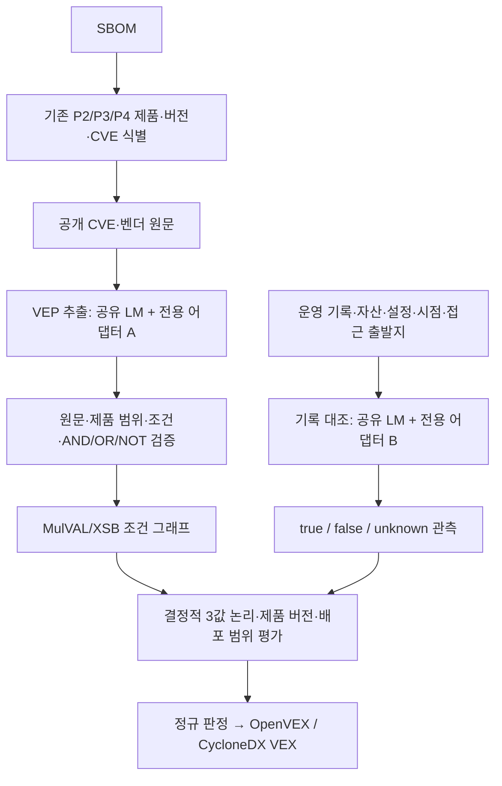

# ICS-VEXForge

소스코드가 없는 ICS/OT 환경에서 SBOM으로 제품·버전·CVE를 식별하고, 공개 원문과 운영 기록으로 VEP 및 VEX를 평가하는 연구용 시스템입니다. 문서 기준: **2026-11-19 KST**.

## 현재 구성



두 어댑터는 동일한 Qwen2.5-Coder-14B 기저 모델을 공유하고 가중치·별칭·학습 정답을 분리합니다. VEP용은 `exploitation-prerequisites`, 운영 기록용은 `operating-record-review`입니다. VEP·기록 대조 중에는 기존 식별용 어댑터를 사용하지 않으며, 작업이 끝나면 원래 식별 어댑터를 복원합니다.

**NLI 분류기와 점수 임계값은 사용하지 않습니다.** 과거 운영 NLI 대조기, 검증 overlay, 전용 실행·평가 스크립트와 상태 API를 제거했습니다. LLM은 조건과 관측을 제안하고, 최종 VEX 상태는 코드가 결정합니다. 추출이나 MulVAL 실행이 실패하면 미해결 상태로 남깁니다.

| 출력 | 의미 |
| --- | --- |
| `product_applicability` | 원문 제품·실행 버전의 적용 여부 |
| `prerequisite_status` | 원문 조건식의 충족·불충족·미확정 |
| `deployment_exploitability` | 해당 배포 범위에서 알려진 조건 충족·경로 차단·미확정 여부 |
| `product_vex_status` | 별도 근거를 적용한 제품/컴포넌트 범위의 VEX 상태 |

VEP는 `V1~V7`, `operator`, `expected`, `necessity`, 근거 직접성·검토 상태를 보존합니다. V1 제품 영향 정보는 운영 조건 노드와 분리합니다. `contextual`·미확정 후보를 실행 조건에 자동으로 AND하지 않습니다. NIST 수집 항목과 18개 자산 유형은 질문 맥락이며 CVE 조건이나 사실값을 만들지 않습니다.

네트워크 차단·서비스 비활성화·알려진 경로의 불충족만으로 제품을 `not_affected`로 바꾸지 않습니다. `fixed`에는 공급사 근거가 있는 수정 실행 버전이 필요합니다. 미배포·공급사의 명시적 비영향 버전은 별도 근거로 처리하며, 근거 부족·충돌·미확정 제품 연결은 `under_investigation`입니다. 그래프의 조건 충족은 실제 공격 성공이나 침해의 증거가 아닙니다.

상세 문서: [컴포넌트 흐름](docs/COMPONENT_VEX_WORKFLOW.md), [VEP 계약](docs/VULNERABILITY_EXPLOITATION_PREREQUISITE.md), [사용자 구현 명세](docs/ICS_OT_VEP_USER_SPEC_20261119.md).

## 12,418개 전체 데이터와 어댑터 학습

| 항목 | 확인된 상태 |
| --- | --- |
| 대상 | 사용자가 확정한 고유 CVE **12,418개 전체** |
| 생성·검수 | 두 역할 각각 12,418개 입력–정답 쌍, 총 24,836개. 무결성·입력별 정답 스키마 검사 통과 |
| 역할별 분할 | 학습 8,692 / 개발 1,863 / 최종 평가 1,863 |
| 분할 기준 | 원문 문서·텍스트를 공유하는 CVE 연결 그룹. 그룹의 구간 중복 0개 |
| VEP 자동 주석 | 조건 후보 5,745개, 논리 시나리오 1,938개, 제품 연결 시나리오 7개(학습 1 / 개발 5 / 시험 1), V1 주장 9,080개 |
| 합성 운영 기록 | true 3,104 / false 3,107 / unknown 6,207 |
| 전용 어댑터 | **H200에서 학습 진행 중. 학습·평가 완료 전 비활성화** |
| 최종 평가 | 고정 체크포인트로 역할별 TEST 1,863개 전수 평가. 학습 후 자동 실행 |

데이터는 [manifest](benchmark/prerequisite_roles_20261119_v7/manifest.json), [무결성 검사](benchmark/prerequisite_roles_20261119_v7/integrity_audit.json), [정답 스키마 검사](benchmark/prerequisite_roles_20261119_v7/target_schema_audit.json)에 기록합니다. 진행 상태는 [최근 실행 상태](results/role_adapters_20261119_v2/latest_status.json), 데이터 생성·학습·평가 절차는 [학습 데이터 문서](docs/PREREQUISITE_ROLE_TRAINING_DATA.md)에 있습니다.

VEP 정답은 기존 원문 규칙과 제한된 패턴으로 만든 **자동 약지도 주석**이며 전문가 Gold가 아닙니다. CVE별 원문 하나·제품 최대 하나의 범위로, 모든 제품·경로를 완전히 주석한 자료가 아닙니다. 제품 연결 양성이 적어 일반적인 제품 연결 성능을 입증하지 못합니다. 제품 연결이 미확정인 시나리오는 실행 경로로 사용하지 않습니다. 원문 조건을 확보하지 못한 CVE도 미해결 사례로 유지합니다. 필드별 주석 분포와 평가 가능한 범위는 [주석 분포](results/role_adapters_20261119_v2/data_label_coverage.json)에 기록합니다.

운영 기록은 실제 현장 자료가 없는 상태에서 만든 합성 자료입니다. 원문 기반 관측 가능한 후보가 없으면, 해당 CVE의 조건이라고 주장하지 않는 가상 조건으로 대조 사례를 만듭니다. 과거 기록·미적용 계획·다른 자산/빌드·정보 누락·충돌은 unknown을 학습합니다. 잠재 정답은 모델 입력과 분리합니다.

각 역할의 TRAIN 전체를 한 번 학습하며, 두 어댑터의 최적화와 가중치를 분리합니다. 초기 QLoRA 체크포인트에서 고정 기저 가중치를 BF16로 펼친 LoRA 학습으로 이어간 자원 변경 이력을 보존하고, 최종 평가는 원래 고정된 4비트 기저 모델을 사용합니다. TEST 정답을 최적화나 체크포인트 선택에 사용하지 않습니다. 출력 실패도 평가 분모에 포함합니다. VEP 지표는 자동 주석 일치도, 기록 대조 지표는 합성 정답 정확도이며 실제 OT 정확도나 악용 가능성 Precision 90% 달성을 뜻하지 않습니다.

```powershell
# 현재 고정 데이터 검사 / 진행 조회
python -X utf8 -B tools/build_prerequisite_role_data.py audit
python -X utf8 -B tools/run_prerequisite_role_training.py status --compact

# 현재 실행이 끝날 때까지 관찰 / 완료 산출물 다운로드
python -X utf8 -B tools/run_prerequisite_role_training.py watch
python -X utf8 -B tools/run_prerequisite_role_training.py fetch

# 학습·평가가 끝난 두 가중치의 해시·기저 모델을 검사하고 로컬에 설치
python -X utf8 -B tools/install_prerequisite_role_adapters.py
```

확정 데이터와 실행 ID를 덮어쓰지 않습니다. 새 데이터는 `build --output <새 경로>`로 만듭니다. 현재 학습을 다시 시작하기 위해 `launch`를 중복 실행하지 않습니다. 설치 명령은 기본적으로 가중치를 비활성 상태로 보관하며, 서비스에 연결할 때 `--activate`를 지정합니다. 가중치 활성화 설정은 [prerequisite_adapter_roles.json](data/prerequisite_adapter_roles.json)이며 실제 학습 완료 표식·역할·기저 모델·가중치 해시를 검사합니다.

## 로컬 실행

Python 3.10과 CUDA용 PyTorch를 사용합니다. 의존성은 [requirements-precision.txt](requirements-precision.txt), 원격 학습 환경은 [requirements-ncp.txt](requirements-ncp.txt)를 참고하세요. 기저 모델·어댑터·원천 자료는 별도 준비가 필요합니다.

```powershell
git lfs install
git lfs pull
python -X utf8 -B tools/serve_nist_operational_vex.py 8100
```

| 화면/API | 주소 |
| --- | --- |
| BOM 업로드·식별·컴포넌트별 검토 | http://127.0.0.1:8100/bom-vex.html |
| 운영 관측 기반 VEX | http://127.0.0.1:8100/vex-decision.html |
| 기존 SBOM/CVE 조회 | http://127.0.0.1:8100/index.html |
| 방법론 | http://127.0.0.1:8100/nist-population-vex-method.html |
| API 문서 | http://127.0.0.1:8100/docs |
| 생성형 모델·어댑터 상태 | `/api/operational-vex/llm-status` |
| VEP 스키마 | `/api/operational-vex/prerequisite-schema` |

서비스 진입점은 [serve_nist_operational_vex.py](tools/serve_nist_operational_vex.py)입니다. 기반 서비스 위치는 `local-service/sbom-vex/vex_operational_logic_20261117`, 배포 파일 목록은 [runtime_manifest.json](local-service/runtime_manifest.json)입니다. `tools.local_dataset_app:app`은 별도 기존 데이터셋 서비스입니다. 현재 PC의 기저 모델 캐시는 `D:\ICS-VEX-support\cache\huggingface`이며, 실행 메타데이터와 파일 해시가 일치해야 합니다. 서비스의 HTTP 정상 응답과 모델 정확도는 별개입니다.

## 코드와 검증

| 위치 | 역할 |
| --- | --- |
| `src/vulnerability_exploitation_prerequisite.py` | VEP 추출·출처/제품/관계 검사·질문 컴파일 |
| `src/prerequisite_adapters.py` | 역할별 어댑터 검증·선택·복원 |
| `src/operational_record_llm.py` | 생성형 운영 기록 대조·보류 정책 |
| `src/nist_attack_graph.py`, `src/mulval_prerequisites.py` | 조건 그래프와 실제 MulVAL/XSB 연결 |
| `src/exploitability_analysis.py`, `src/nist_auto_vex.py` | 결정적 판정·분리 출력·VEX 내보내기 |
| `tools/*prerequisite_role*.py` | 전체 데이터 생성·학습·평가·진행 조회 |
| `tests/` | 계약·근거·논리·API 회귀 검사 |

```powershell
python -X utf8 -B -m pytest tests/test_vep_llm.py tests/test_prerequisite_adapters.py tests/test_prerequisite_role_data.py tests/test_component_operational_workflow.py -q
```

실제 MulVAL이나 GPU 추론 검사는 별도 실행 환경이 필요합니다. 합성 응답을 사용하는 회귀 검사는 연결과 정책을 확인하며 독립적인 의미 정확도 검증이 아닙니다.

## 보존된 연구 이력

기존 식별 평가, Gold v5, 자산 분류·NER 실험은 현재 두 어댑터의 평가와 분리해 보존합니다. 이전 수치와 재현 경로는 [정리 전 README](docs/archive/README_20261119_before_role_adapter_cleanup.md)에 있습니다. 삭제한 구형 코드의 목록·해시·복구용 원본은 [폐기 기록](results/legacy_logic_retired_20261119/manifest.json)에 보존합니다. 현재 학습 데이터·가중치·검토 DB·실험 결과를 삭제하지 않습니다.

H200 연결 정보와 서비스 포트 구분은 [NCP 안내](docs/NCP_MIGRATION.md)를 참고하세요. kubeconfig·토큰은 Git에 포함하지 않습니다.
