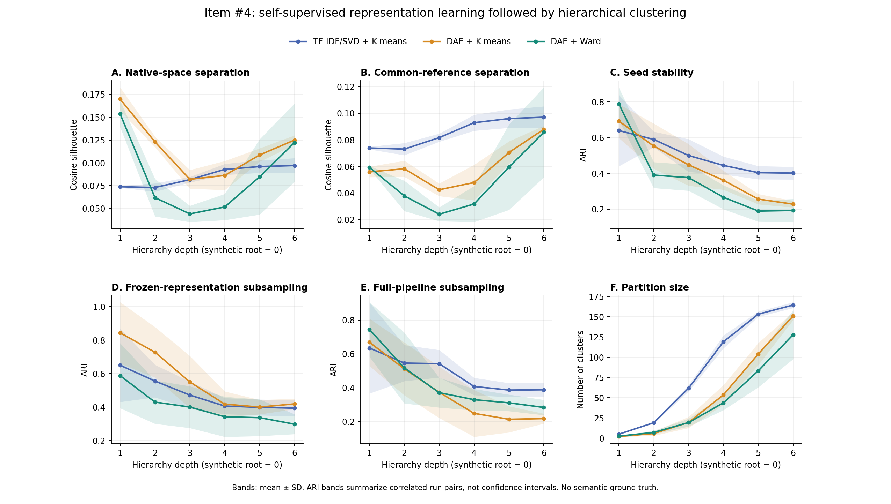
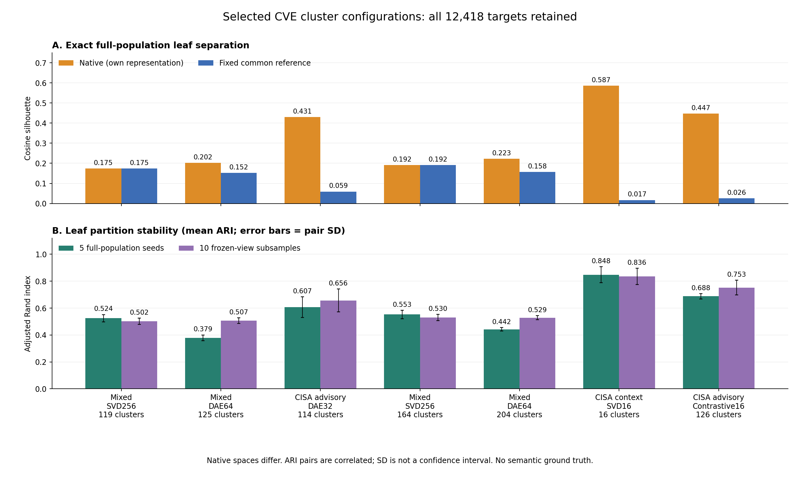

# #4 표현 학습·군집화 비교 실험과 최종 선택

기준일: 2026-11-15 KST. CISA ICS/ICSA의 고유 CVE **12,418개** 전체로 입력·차원·자기지도학습 유무·군집화 방식을 비교했다. 공인시험 #4의 VEX Affected 정밀도 시험과 별개이며 Silhouette·ARI를 공인시험 합격률로 해석하지 않는다.

## 최종 선택: TF-IDF → SVD16 → GPU K-means

**CISA 맥락 텍스트 → TF-IDF → SVD16 → GPU K-means를 최종 선택했다. 군집은 16개, 전수 native cosine Silhouette는 0.5866171296755885다. 12,418개 CVE 모두 실제 배정했으며 자기지도학습은 사용하지 않았다.** 자기지도 비교 후보의 126개 군집과 구분한다.

| 최종 선택 결과 | 값 |
| --- | --- |
| 후보 / 표현 | `native_gain` / `cisa_context_raw16_seed42` |
| 최종 잎 군집 수 | **16개**, 요청 K=16, 작은 군집 병합 0개 |
| 대상 / Silhouette 질의점·비교 대상 | **12,418개 / 각각 12,418개** |
| Native cosine Silhouette | **0.5866171296755885** |
| 공통 참조 cosine Silhouette | **0.017200194323733996** |
| seed 반복 ARI | **0.8478954625009353**, 5회 실행의 10쌍 평균 |
| 표현 고정 재표집 ARI | **0.8361796740030867**, 10회 실행의 45쌍 평균 |
| 군집 크기 | 최소 153개, 최대 2,188개 |
| 최종 배정 | [16개 군집 CSV](../../results/item4_cisa_lowrank_v1/export/cve_clusters_cisa_context_svd16.csv) |
| 원시 근거 | [전수 점수](../../results/item4_cisa_lowrank_v1/selected/native_gain/full_population_metrics.json), [설정](../../results/item4_cisa_lowrank_v1/selected/native_gain/selection.json), [안정성](../../results/item4_cisa_lowrank_v1/selected/native_gain/stability_summary.json) |

### 선택 기준과 해석

전수 평가한 **최종 잎 분할 후보들** 중 native Silhouette가 가장 높은 결과를 선택했다. 모든 상위 해상도까지 통틀어 가장 높은 값이라는 뜻은 아니다. 이 후보의 상위 11개 군집 해상도는 0.6146이지만, 사전에 고정한 최종 잎 해상도 6의 비교를 유지해 16개를 채택했다. 탐색 질의점 1,000개의 선별 점수 0.575582와 최종 전수 점수 0.586617도 구분한다. 여러 설정을 탐색한 데이터셋 내 결과로 미학습 CVE 일반화 성능은 아니다.

다른 임베딩 공간의 native 값을 직접 의미 정확도로 비교하지 않는다. 공통 참조 점수 0.0172도 함께 공개한다. 의미적 군집 품질·운영 질문 호환성·VEX 판단 정확도는 별도 검증이 필요하다. **자기지도 과제 F1 0.8073은 별도 대조학습 모델의 점수이며 이 16개 군집 모델의 점수가 아니다.**

### 최종 방법의 실제 실행 설정

1. **입력:** CVE별 CISA 설명 + 관련 권고문의 공유 위험·기술 맥락인 `cisa_context`. 정보 부족 항목은 공유 맥락 사용을 표시하고 전수 포함했다. 법적 문구·일반 보안 권고·위치 정보는 제외했지만 제조사·제품명은 일괄 제거하지 않았다.
2. **TF-IDF:** 단어 unigram/bigram, 최대 특성 20,000개, `min_df=2`, `max_df=.98`, sublinear TF, 부정 표현을 보존한 불용어 처리. 동일 텍스트를 적합 단계에서 중복 제거하되 모든 CVE 배정을 유지했다.
3. **SVD16:** 실제 구현은 seed 42로 적합한 **TruncatedSVD256의 앞 16성분을 선택한 후 L2 재정규화**했다. 별도의 SVD16 재적합은 아니다. SVD는 선형 차원 축소이며 이 후보에는 자기지도 신경망이 없다.
4. **K-means:** 정규화된 16차원 벡터에 GPU Euclidean K-means, k-means++ 초기화, `n_init=3`, 최대 80회 Lloyd 갱신, seed 42, K=16. 최소 크기 30 규칙이 있지만 실제 최소 크기 153으로 병합이 없었다. 군집화 목적함수는 Euclidean, 보고한 Silhouette는 cosine이다.
5. **계층:** 최종 16개 잎 중심을 정규화해 비가중 Ward 병합했다. 저장 해상도는 **2 → 3 → 5 → 7 → 11 → 16개**, 실제 최대 간선 깊이는 6이다. 상위 계층 추가로 최종 잎 배정은 변하지 않는다.
6. **평가:** 전수 cosine Silhouette와 고정 초기 혼합 입력 SVD256의 참조 Silhouette를 병기했다. seed 5회, 표현 고정 입력 그룹 약 80% 재표집 10회를 평가했다. 재표집은 공통 CVE만 정렬해 ARI를 계산했으며 교집합은 7,814~8,006개다. 최종 CSV는 12,418개 전체다.

## 수행한 모든 방법 총괄

아래는 방법군별 실제 수행 범위다. 이어지는 절에 입력 5종·모델 구조·학습 조건·분할 및 종료·평가·결합 입력 수정·출처 분리 시험을 상세히 기록했다.

| 방법군 / 단계 | 방법론 | 수행 범위와 결과 |
| --- | --- | --- |
| 초기 기준선 | 혼합 출처 → TF-IDF/SVD256 → 재귀 K-means | 최대 깊이 6, 마지막 깊이 평균 참조 Silhouette 0.0971 |
| 초기 자기지도 표현 비교 | 같은 SVD256 → 잡음 복원 DAE64 → 같은 재귀 K-means | 마스킹·Gaussian 잡음에서 MSE 복원. 마지막 깊이 평균 참조 0.0880 |
| 초기 군집화 알고리즘 비교 | 동일 DAE64 → 재귀 Ward | 마지막 깊이 평균 참조 0.0857. 위 3방법의 seed·표현 고정 및 전체 파이프라인 재표집 합계 **105개 계층 결과** |
| 1차 입력·표현 탐색 | 입력 5종 × SVD64/128/256·DAE32/64·이웃 대조학습32/64 × K 6종 | **210개 평면 조건**, 선별 표현 5종 × 재귀 K-means/Ward = 10개 계층 비교 |
| 전역 잎 + 프로토타입 계층 | 전역 GPU K-means → 잎 중심 Ward 병합 | 혼합 SVD256 119개, 혼합 DAE64 125개, CISA 풀링 DAE32 114개, CISA 설명 SVD256 119개 군집. 각 전수·seed 5회·재표집 10회 |
| 2차 저차원·K 확대 탐색 | 입력 5종 × SVD16/32·DAE16·이웃 대조학습16 × K 6종 + 기존 3표현 K 확대 | **129개 추가 조건**. 승격 후보의 최종 군집 수 164 / 204 / **16** / 126개. 각각 전수·seed 5회·재표집 10회 |
| 결합 입력 수정 대조군 | 혼합·CISA 맥락의 차원을 절반씩 유지한 SVD16/32/64/128 × K 6종 | **24개 조건**. 단순 prefix가 첫 입력만 남기는 문제를 수정·검증. 최종 선택을 대체하지 않음 |
| 자기지도 과제 자체 평가 | CISA 권고문 풀링 → 학습 출처만으로 전처리·이웃 대조학습 → 양성/음성 쌍 판별 | CVE 학습/검증/시험 8,692/1,863/1,863. 혼합 시험 F1: 원본 0.8293 / 학습 전 0.7283 / 학습 후 0.8073. 군집 정확도와 구분 |

평면 탐색 합계는 **363개 조건 = 210 + 129 + 24**다. 105개 초기 계층 비교와 후속 계층 결과는 평면 조건 수와 별도 집계다. 입력 5종은 혼합 출처·CISA CVE별 설명·CISA 맥락·권고문 벡터 평균 풀링·혼합/CISA 균형 결합이다. K 6종은 4/8/16/32/64/128, 확대 K는 192/256/384다. 모든 전수 실행은 12,418개 CVE를 포함했다.

DAE는 잡음 입력에서 깨끗한 SVD 입력을 복원하는 MSE 자기지도학습이다. 이웃 대조학습은 입력의 최근접 이웃 5개를 양성으로 선택하고 두 입력을 10% 마스킹해 symmetric InfoNCE(온도 .1) + .1 코사인 관계 MSE를 학습하는 변형이다. 무작위 초기화 MLP를 사용했고 LLM·사전학습 언어모델·CWE 정답 라벨을 사용하지 않았다. 상세 구조·optimizer·epoch는 아래 절과 저장 프로토콜에 기록했다.

## 목적과 범위

1. 자기지도학습이 없는 기준선과 비교해 표현 학습의 효과를 조사한다.
2. 동일한 학습 표현에서 분할 방식의 차이를 조사한다.
3. 깊이에 따른 분리도와 초기화·자료 재표집 안정성을 측정한다.

LLM, 사전학습 언어모델, CVSS·CWE 정답 라벨, 보고서의 20개 범주를 학습에 사용하지 않는다. 기존에 보고된 CWE는 수정하지 않는다. 데이터의 식별 모호성·기존 제외 표시는 메타데이터로 보존한다. 이 실험은 원문 그대로의 텍스트 군집을 만들며 자산 영향이나 CVE 정체성을 확정하지 않는다. 모든 전수 실행에서 12,418개 ID가 보존돼야 하며 빈 텍스트·영벡터가 나오면 조용히 제외하지 않고 실패시킨다.

원본은 `results/ics_sentence_conditions_v1/full_inputs.jsonl`, 대상 집합 대조는 `data/item3_ics_cert_full_v1/cves.jsonl`을 사용한다. 외부 자료를 새로 수집하는 작업이 아니다. 입력·코드·CWE 카탈로그 해시와 실행 환경을 결과에 고정한다.

## 실제 입력 구성: CISA 설명을 이미 포함

현재 실험은 NVD 설명만 사용하는 실험이 아니다. 고정한 원본의 출처를 직접 집계한 결과는 다음과 같다.

| 입력 구성 | CVE 수 |
| --- | ---: |
| NVD 설명 + 검증된 CISA CSAF CVE별 설명 | 8,910 |
| NVD 설명만 있고 검증된 CISA CVE별 설명 없음 | 3,491 |
| NVD 설명 없음 | 17 |
| 전체 | **12,418** |

NVD 설명은 12,401개 CVE에 있으며, 검증된 CISA CVE별 설명은 8,926개 CVE에 있다. 출처 항목 수는 NVD 12,401개, 검증된 CISA 설명 9,399개다. 별도로 식별 미해결 관련 권고문 본문 1개가 원본에 남아 있으며 모호성 표시를 보존한다. 권고문 전체 본문을 모든 연결 CVE에 일괄 추가하는 구조는 아니다. 세부 집계는 결과의 `data_source_audit.json`에 기록했다.

현재 세 방법은 **이 동일한 혼합 입력**에서 표현 학습·분할 방식을 비교한다. 이 결과로 CISA 추가 여부의 효과를 판단하지 않는다.

입력 보강의 효과는 별도 요인 실험으로 구분한다. 사용자는 **모든 전수 실험에 12,418개 CVE가 실제로 배정돼야 한다**고 명시했다. 따라서 17개가 빠지는 NVD-only 실행이나 정보가 모두 있는 하위집합만으로 전체 결과를 대신하지 않는다. 후속 탐색은 CISA 자료가 부족한 항목에도 관련 권고문 공유 맥락을 범위 표시와 함께 사용해 전수 입력을 유지한다. 없는 CVE별 사실이나 가짜 벡터를 만들지 않는다.

권고문 전체를 CVE마다 반복 부착하면 다른 CVE의 설명, 공통 영향 문장, 일반 보안 권고, 제조사·제품명이 군집을 좌우할 수 있다. CVE 귀속 범위를 보존하고 일반 권고는 악용 전제조건으로 해석하지 않는다. 확장 시에는 같은 권고문을 공유하는 CVE 사이의 일치도가 전체 안정성을 과도하게 높이는지도 별도 진단해야 한다.

## 세 가지 비교 방법

| 방법 키 | 표현 | 계층 분할 |
| --- | --- | --- |
| `svd_kmeans` | TF-IDF → SVD 256차원 → L2 정규화 | 재귀 K-means |
| `ssl_kmeans` | 같은 입력 → Denoising Autoencoder의 64차원 잠재벡터 → L2 정규화 | 같은 재귀 K-means |
| `ssl_ward` | `ssl_kmeans`와 **동일한** 잠재벡터 | 재귀 Ward 분할 |

TF-IDF는 단어 unigram/bigram, 최대 20,000개 특성, `min_df=2`, `max_df=.98`, sublinear TF를 사용한다. 같은 출처 원문과 동일한 정제 텍스트는 학습 전에 중복 제거하되 연결된 CVE는 출력에서 모두 유지한다. CVE/CWE ID, CVSS 벡터·점수 상투문, URL을 제거하고 부정 표현은 불용어 목록에서 제외한다. 제품·제조사 이름을 자동 제거하지 않으므로 제품명·문서 양식에 따른 군집 가능성은 원문 검토 대상으로 남는다.

자기지도 모델은 무작위 초기화한 `256 → 512 → 256 → 64 → 256 → 512 → 256` 완전연결 오토인코더다. 정규화 입력에 `sqrt(256)`을 곱해 스케일을 맞추고, 특성 20% 마스킹과 표준편차 .05의 Gaussian 잡음을 넣은 입력에서 깨끗한 입력을 복원한다. 목적함수는 MSE, optimizer는 Adam(lr=.001), 배치는 512, 학습은 100 epoch이다. 분류 정답 없이 입력 자체를 복원 목표로 사용한다. 학습 후 인코더를 고정한다. IDEC처럼 군집 손실과 표현을 공동 최적화하지 않는다.

## 최대 깊이와 분할·종료

`data/cwe_taxonomy/current.json`이 가리키는 카탈로그와 CWE-1000의 `ChildOf` 관계를 고정한다. 복수 부모 경로를 보존하고, 실제 최장 경로의 노드 수를 깊이 상한으로 사용한다. 현재 저장된 CWE v5.0에서는 **6**이다. 전체 CVE를 담는 가상 루트는 깊이 0, 첫 분할은 깊이 1이다.

추상화 유형 `Pillar / Class / Base / Variant`의 종류 수인 4와 실제 경로 길이를 구분한다. 같은 유형 안에 여러 부모·자식 항목이 이어질 수 있다. 이 숫자는 실험의 구조 상한이며 학습 군집의 각 단계가 실제 CWE 의미 수준에 대응한다는 주장은 하지 않는다.

각 부모 군집에서 자식 수 `k=2,3,4,5`를 비교한다. K-means는 `n_init=5`, Ward는 정규화 벡터의 Euclidean linkage로 후보 분할을 만든다. 두 방식 모두 동일한 native cosine Silhouette 기준으로 가능한 후보 중 가장 높은 것을 선택한다. 거의 같은 점수에서는 작은 k를 유지한다.

- 부모가 100개 미만이거나 자식마다 최소 30개를 확보할 수 없으면 종료한다.
- 최대 깊이에 도달하면 종료한다.
- 가능한 분할의 local Silhouette가 .02 미만이면 종료한다.
- 종료한 가지는 이후 깊이에서도 **같은 부모 군집 ID를 유지**한다.

크기·점수 기준은 사전 선언한 탐색 설정이며 검증된 의미 경계가 아니다. ARI는 분할 후 평가에 사용한다. 모든 가지를 깊이 6까지 강제하거나 군집 수를 20으로 맞추지 않는다.

## 반복과 재표집

| 실행군 | 횟수 | 바꾸는 것 | 고정하는 것 |
| --- | ---: | --- | --- |
| `seed` | 5 | seed 42~46의 신경망 초기화·학습 순서·K-means 초기화·local 평가 표본 | 전체 CVE와 전처리 |
| `frozen_resample` | 20 | 정제 텍스트 그룹의 80%를 복원 없이 추출 | 전수 seed 42 표현·전처리·분할 seed |
| `pipeline_resample` | 10 | 위 20개 중 첫 10개와 같은 표본에서 전처리·표현 학습부터 재실행 | 모델 구조·분할 설정·학습 seed |

이는 복원 추출 bootstrap이 아니라 **subsampling**이다. 동일한 정제 텍스트를 가진 CVE는 함께 뽑아 정확한 중복이 서로 다른 표본으로 흩어지는 효과를 줄인다. 실제 CVE 비율은 그룹 크기에 따라 80%와 조금 다를 수 있으며 실행별 ID를 저장한다. 근사 중복·공통 권고문 양식의 영향까지 제거했다고 주장하지 않는다.

`seed`의 Ward 결과에는 신경망·local 평가 표본 변화가 반영되며 Ward 자체에 무작위 초기화가 있다는 의미는 아니다. `frozen_resample`과 `pipeline_resample`의 차이를 통해 표현 고정 조건의 안정성과 전체 과정의 안정성을 구분한다.

## 깊이별 Silhouette

각 깊이 1~6에서 전체 실행 집합이 하나의 분할을 이루도록 평가한다. 단일 군집 등 정의 불가능한 결과는 N/A로 보존한다. 전체 ID의 고정 해시 순서로 평가 질의점 2,000개를 먼저 정하고, 재표집 실행에서는 그중 해당 표본에 포함된 CVE를 사용한다.

각 질의점의 Silhouette는 **그 실행의 모든 CVE까지의 거리**로 계산한다. 질의점끼리만 만든 작은 집합의 Silhouette가 아니다. 각 실행 안에서 방법 간·공간 간 질의점 ID를 동일하게 맞춘다.

| 지표 | 공간 | 해석 |
| --- | --- | --- |
| native Silhouette | 각 방법의 L2 정규화 표현 | 그 표현에서의 분리도 |
| reference Silhouette | 전체 자료로 한 번 고정한 TF-IDF/SVD 공간 | 같은 거리 기준에서의 결과 비교 |

모든 평가 거리는 cosine distance다. 공통 참조 공간은 보편적인 의미 정답이 아니며 TF-IDF/SVD의 어휘 편향을 가진다. 두 지표를 병기하고 한쪽만으로 신경망 우월성을 단정하지 않는다. 전체 자료로 만든 참조 공간은 `pipeline_resample`에서 **평가에만** 사용하며 그 표본의 모델 학습에 넣지 않는다.

## 깊이별 ARI

같은 실행군·같은 방법의 모든 실행 쌍을 비교한다. 각 쌍에서:

1. 공통 CVE ID의 교집합을 구한다.
2. 같은 순서로 정렬한다.
3. 같은 깊이의 군집 배정으로 ARI를 계산한다.
4. 공통 CVE 수, 교집합 위의 군집 수, 퇴화 여부를 함께 저장한다.

군집 번호는 수동 매칭하지 않는다. 번호를 바꿔도 ARI는 같다. 깊이마다 조기 종료된 가지가 유지되므로 비교 대상에서 누락되지 않는다. 양쪽이 모두 단일 군집이라 ARI=1인 경우를 좋은 안정성으로 오해하지 않도록 퇴화 쌍을 별도 표시하고 비퇴화 쌍의 집계도 제공한다.

ARI 평균·표준편차·p10/p90·범위를 제공한다. 실행 쌍들은 서로 자료를 공유하므로 독립 표본이 아니며, 이 값들을 95% 신뢰구간으로 부르지 않는다. 서로 다른 방법 간 ARI는 `cross_method_agreement.jsonl`에 **방법 간 일치도**로 별도 기록하고 반복 안정성과 혼용하지 않는다.

## 실행과 재개

CUDA GPU와 로컬 Python의 NumPy·SciPy·scikit-learn·PyTorch·joblib이 필요하다. 신경망 학습과 거리 행렬 곱은 GPU, TF-IDF/SVD·K-means·Ward·ARI 집계는 CPU에서 수행한다. GPU lease를 확인하고 실행 동안 점유를 기록한 뒤 해제한다. 모델 다운로드는 하지 않는다.

```powershell
python -m pytest tests/test_item4_ssl_hierarchy.py -q
python tools/run_item4_ssl_hierarchy.py --output results/item4_ssl_hierarchy_v1
python tools/render_item4_ssl_hierarchy.py --output results/item4_ssl_hierarchy_v1
```

동일한 명령을 다시 실행하면 완료된 표현·분할을 재사용한다. 입력·코드·설정 해시가 바뀌었으면 기존 결과를 덮어쓰지 않고 새 출력 경로를 요구한다. 기본 실험은 35개 실행 집합 × 3개 방법 = **105개 계층 결과**이다.

## 결과와 상태

기존 고정 비교는 완료했다. 35개 실행 집합 × 3개 방법의 **105개 계층 결과**를 생성했고, 전수 실행마다 12,418개 CVE 보존과 깊이별 분할·부모/자식 정합성 검사를 통과했다. 실행 시간은 약 31분이었다. 후속 CISA 중심 탐색의 완료 여부는 해당 실험의 별도 상태 파일로 구분한다.

| 파일 | 내용 |
| --- | --- |
| `status.json`, `jobs.json` | 현재 단계와 완료 실행 목록 |
| `protocol.json`, `environment.json`, `code_snapshot/` | 고정 조건·환경·실행 코드 |
| `corpus_index.jsonl` | 12,418개 ID·원문 출처·원래 상태 표시 |
| `runs/*/*/levels.npy`, `tree.json` | 깊이 0~6의 배정, 노드별 분할·종료 이유 |
| `runs/*/encoder.pt`, `training_history.json` | 자기지도 가중치·학습 손실 |
| `depth_metrics.jsonl`, `comparison_summary.json` | 깊이별 Silhouette·군집 수·크기 편중 |
| `ari_pairs.jsonl`, `stability_summary.json` | 교집합별 ARI 원시값과 집계 |
| `cross_method_agreement.jsonl` | 같은 실행에서 방법 간 일치도 |
| `reference_assignments.jsonl` | seed 42 전수 실행의 모든 CVE·세 방법·모든 깊이 배정 |
| `representative_cves.jsonl` | 군집별 대표 CVE와 출처 원문 |
| `verification.json`, `manifest.json` | 전수 보존·계층 정합성 검사와 산출물 해시 |
| `report.html` | 비교표와 해석 제한 |
| `comparison.png`, `comparison.svg` | 깊이별 분리도·안정성 곡선. 음영은 표준편차이며 신뢰구간이 아님 |

### 기존 고정 비교의 측정 결과

아래는 최대 깊이인 6에서의 요약이다. 깊이 1~6의 전체 결과와 표준편차·분위수는 결과 JSON과 곡선에 보존했다. Silhouette는 seed 5회 평균이며 고정한 질의점에서 실행 집합 전체까지의 거리로 계산했다. ARI는 각 실행군의 모든 비퇴화 실행 쌍 평균이다.

| 방법 | 공통 참조 Silhouette | seed ARI (10쌍) | 고정 표현 재표집 ARI (190쌍) | 전체 재학습 재표집 ARI (45쌍) |
| --- | ---: | ---: | ---: | ---: |
| `svd_kmeans` | 0.0971 | 0.4017 | 0.3939 | 0.3878 |
| `ssl_kmeans` | 0.0880 | 0.2281 | 0.4192 | 0.2173 |
| `ssl_ward` | 0.0857 | 0.1926 | 0.2985 | 0.2834 |

이 설정에서 자기지도학습은 native 점수를 높였지만 공통 참조 공간과 전체 재학습 안정성의 일관된 개선을 보이지 않았다. 고정 표현의 재표집만으로 표현 학습까지 안정적이라고 판단하면 안 된다. 이 결과를 보존한 채 입력·표현 탐색을 별도 수행한다.

평가 의미를 확인하는 단위 테스트 7개가 통과했다. 원문 의미·운영 질문·VEX 정확도 검증을 뜻하지 않는다.



## 해석 제한과 다음 평가

Silhouette와 재표집 ARI는 기하학적 분리도·안정성 지표다. 보고서의 20개 범주, 운영자가 같은 질문에 답할 수 있는지, 실제 자산의 악용 가능성, VEX 상태의 정확도를 검증하지 않는다. 원문 대표 사례와 경계 사례를 따로 검토해야 한다. 학습 손실 감소 역시 의미 정확도의 증거가 아니다.

현재는 전체 모집단에 대한 transductive 분석이다. 새 CVE에 대한 일반화·추론 성능을 주장하려면 별도의 미학습 자료와 새 문서 군집 배정 규칙을 설계해야 한다. 이 실행으로 운영 웹 경로·CWE 라벨·VEX 판정은 자동 변경하지 않는다.

공식 참고: [Silhouette](https://scikit-learn.org/stable/modules/generated/sklearn.metrics.silhouette_score.html), [ARI](https://scikit-learn.org/stable/modules/generated/sklearn.metrics.adjusted_rand_score.html), [Ward linkage](https://docs.scipy.org/doc/scipy/reference/generated/scipy.cluster.hierarchy.linkage.html), [CWE-1000](https://cwe.mitre.org/data/definitions/1000.html).

## 후속: CISA 중심 입력·표현 탐색

사용자의 후속 요청에 따라 Silhouette 개선 후보를 반복 탐색한다. 결과 경로는 `results/item4_cisa_silhouette_search_v1`이며 기존 고정 조건 비교와 분리한다. 실행 중인 탐색을 완료된 결과로 오해하지 않도록 `status.json`을 확인한다.

**모든 유효 후보의 입력·군집 배정 수는 무조건 12,418개**다. 점수가 낮거나 식별이 모호한 CVE를 제외하지 않는다. 자료 부족 항목을 명단에만 남기고 군집화 대상에서 빼는 것도 허용하지 않는다. 작은 군집은 점을 버리지 않고 가까운 큰 군집으로 병합한다. 하나라도 빠지면 해당 실행은 실패다. 재표집만 안정성 시험용 부분집합을 사용한다.

### 입력과 표현

| 입력 키 | 구성과 범위 |
| --- | --- |
| `current_mix` | 기존 전수 비교와 같은 혼합 출처 SVD 입력 |
| `cisa_scoped` | 원본 CSAF의 CVE별 summary/description 또는 기존 CISA 캐시의 CVE별 설명. 없는 항목은 공유 맥락임을 명시 |
| `cisa_context` | CVE별 설명 + 관련 권고문의 공유 위험·기술 맥락 |
| `cisa_advisory_pool` | 권고문을 각각 벡터화한 뒤 연결된 권고문 벡터를 CVE별 평균. 문서 주제·공유 효과를 포함하는 별도 실험 |
| `balanced_views` | 기존 혼합 입력과 CISA context의 128차원씩을 각각 정규화해 균형 결합 |

보관된 CSAF JSON이 있으면 원본의 CVE 키로 해당 설명을 연결한다. 권고문 공통의 legal/recommended practices·국가·본사 위치 항목은 제외한다. 레거시 캐시를 사용한 경우와 CVE별 설명이 없어 공유 맥락을 사용한 경우를 별도로 기록한다. 공유 위험 문구나 다른 CVE를 포함하는 문서 주제를 개별 CVE의 필수 악용 조건으로 주장하지 않는다. `input_coverage.json`, `cve_advisory_links.jsonl`, `advisory_provenance.jsonl`에 실제 범위와 원본 해시를 남긴다.

각 입력에서 다음 7개 표현을 비교해 총 **35개 표현 후보**를 만든다.

- 자기지도학습 없는 SVD 벡터의 64/128/256차원 표현 3개.
- Denoising Autoencoder 잠재벡터 32/64차원 2개. 100 epoch.
- 특성 이웃을 양성 쌍으로 삼는 대조 자기지도학습 32/64차원 2개. 50 epoch. symmetric InfoNCE + cosine 관계 보존 MSE를 사용한다. 이웃 관계는 휴리스틱이며 같은 취약점 유형이라는 정답이 아니다. 특정 논문의 정확한 재현이라고 주장하지 않는다.

### 1차 탐색과 최종 계층 평가

GPU K-means(Lloyd 갱신, k-means++ 초기화, 3회 초기값)에서 K=4/8/16/32/64/128을 비교한다. 총 210개 평면 후보는 **빠른 선별용**이다. 최소 크기 30 미만 군집의 CVE를 가까운 큰 중심으로 전부 배정하고, 요청 K와 실제 군집 수를 함께 기록한다. 가장 큰 군집의 비율이 .65를 넘는 결과는 선택 대상에서 제외하되 기록은 보존한다.

서로 다른 입력의 유망 후보, 학습된 표현의 최고 후보, native 공간의 최고 후보를 계층 평가 대상으로 남긴다. 고정 비교와 같은 `k=2~5` 재귀 K-means·Ward, 최대 깊이 6, 크기·종료 기준을 적용한다. 모든 깊이의 결과를 보고하고 **주 비교 깊이는 사전에 6으로 고정**한다. 점수가 잘 나온 깊이만 선택해 제시하지 않는다.

기존 혼합 입력의 공통 참조 공간을 그대로 고정한다. 1,000개 탐색 질의점으로 후보를 선택하고, 별도의 1,000개 확인 질의점은 선별에 쓰지 않는다. 이 둘은 점수 추정용 질의점일 뿐이며, 모델과 군집의 대상은 언제나 전수 12,418개다. 모델이 전수 자료로 학습되므로 이를 미학습 CVE의 일반화 시험이라고 부르지 않는다.

최종적으로 공통 참조 점수 최고 후보와 native 점수 최고 후보를 구분한다. 각 후보에 대해 **12,418개 모든 질의점·모든 비교 대상을 사용하는 전수 Silhouette**를 깊이별로 계산하고 모든 CVE의 군집을 내보낸다. 초기값 5회와 고정 표현의 그룹 재표집 10회도 깊이별 ARI로 비교한다. 새 입력 후보의 재표집은 표현 고정 조건이며, 전처리부터 재학습하는 기존 실험의 `pipeline_resample`과 혼용하지 않는다.

native 점수가 높아도 공통 참조 점수·안정성이 낮으면 입력 공간이나 문서 공유 효과일 수 있다. 두 점수를 모두 공개하며 높은 점수만으로 의미 정확도나 VEX 성능 향상을 주장하지 않는다. 탐색·반복 실험 수는 모든 산출물에 남긴다.

```powershell
python -m pytest tests/test_item4_silhouette_search.py -q
# 원본 고정 비교와 GPU가 겹치지 않게 순서대로 실행
python tools/search_item4_cisa_silhouette.py --stage prepare
python tools/search_item4_cisa_silhouette.py --stage search
python tools/search_item4_cisa_silhouette.py --stage validate
```

`--stage all`은 준비·탐색·계층 평가·안정성 검증을 순서대로 실행한다. 동일한 프로토콜로 재실행하면 완료한 후보를 재사용한다. 코드·설정·출처가 바뀌면 새 출력 경로를 요구한다.

### 1차 탐색의 실제 완료 범위

35개 표현 × K 6종의 **210개 평면 조건**, 선별한 5개 표현 × 2개 분할 방식의 **10개 재귀 계층**을 평가했다. 최종 두 재귀 후보의 전수 Silhouette도 계산했다. 이 단계는 `--stage search`로 실행했으므로 해당 두 재귀 후보의 추가 반복 안정성은 미실행이다. 최종 후보 안정성 검증은 아래 전역 잎 군집 기반 계층으로 진행했고, 두 결과를 혼용하지 않는다.

| 재귀 후보 | 잎 군집 수 | Native 전수 Silhouette | Reference 전수 Silhouette | CVE 수 |
| --- | ---: | ---: | ---: | ---: |
| `balanced_views_raw128` + Ward | 146 | 0.1296 | 0.1105 | 12,418 |
| `cisa_advisory_pool_dae32` + Ward | 153 | 0.3758 | 0.0150 | 12,418 |

**결합 입력의 raw-prefix 해석 수정:** 기존 `balanced_views`의 좌표는 `[기존 혼합 입력 128차원, CISA context 128차원]` 순서다. 앞의 16/32/64/128개를 단순 선택한 raw 기준선에는 첫 번째 입력만 남는다. 따라서 이 raw-prefix 조건들은 두 입력 결합의 효과로 해석하지 않는다. 위 `balanced_views_raw128`도 혼합 입력 128차원의 대조군이다. 전체 256개 입력을 사용하는 DAE·대조학습과 raw256은 두 입력을 모두 사용한다. 기존 결과를 지우지 않고 해석을 수정하고, 두 입력을 차원의 절반씩 보존한 별도 기준선을 `results/item4_balanced_prefix_correction_v1`에서 24개 조건으로 검증한다. 모든 조건은 12,418개를 유지한다.

## 전역 잎 군집 + 프로토타입 상위 계층

재귀 분할은 초기 상위 분할에 묶여 전역적으로 좋은 잎 군집이 만들어지지 않을 수 있어, 별도 알고리즘을 비교했다. 전역 GPU K-means의 잎 군집을 고정하고 **정규화한 군집 중심의 비가중 Ward 병합**으로 상위 구조를 만든다. 최종 잎 군집을 보존하므로 높은 평면 점수를 계층이 독립적으로 재발견했다는 뜻은 아니다.

원래 중심 병합 이력은 더 깊을 수 있다. 저장하는 모델은 군집 수 2에서 전체 잎 군집 수까지 기하급수적으로 배치한 **6개 중첩 해상도**로 축약한다. 실제 부모 간선 기준 깊이는 최대 6이다. `resolution_level`은 해상도 번호, `tree.json`의 `depth`는 실제 부모 간선 깊이다. 두 값은 다를 수 있으며 이전 재귀 분할의 같은 숫자 깊이와 동일한 척도로 비교하지 않는다. 동일한 노드 집합이 여러 해상도에서 유지되면 노드 ID도 유지한다.

초기 후보 네 개는 전수 점수와 초기값 5회·표현 고정 그룹 재표집 10회 평가를 완료했다. 아래 Silhouette는 **12,418개 전체 질의점과 전체 비교 대상**으로 계산한 seed 42 결과다. ARI는 최종 잎 해상도의 실행 쌍 평균이며 각각 10쌍·45쌍이다.

| 후보 | 잎 군집 수 | Native 전수 Silhouette | Reference 전수 Silhouette | seed ARI | 재표집 ARI |
| --- | ---: | ---: | ---: | ---: | ---: |
| 혼합 입력 SVD256 | 119 | 0.1747 | 0.1747 | 0.5243 | 0.5016 |
| 혼합 입력 DAE64 | 125 | 0.2017 | 0.1521 | 0.3792 | 0.5066 |
| CISA 권고문 풀링 DAE32 | 114 | **0.4308** | 0.0594 | 0.6072 | 0.6565 |
| CISA CVE별 설명 SVD256 | 119 | 0.1616 | 0.1071 | 0.5445 | 0.5094 |

결과 경로는 `results/item4_prototype_hierarchy_v1`이다. 각 후보의 `cve_assignments.jsonl`, `full_population_metrics.json`, `tree.json`, `structure.json`, `ari_pairs.jsonl`을 확인한다. CISA 권고문 풀링에는 고유 입력 벡터 3,925개가 12,418개 CVE에 연결되므로 문서 공유·정보 중복이 native 점수에 영향을 줄 수 있다. 공통 참조 점수는 낮으며 이를 원래 CVE 설명 기준 분리도의 동등한 개선으로 주장하지 않는다.

## 2차 저차원·군집 수 확대 탐색

`results/item4_cisa_lowrank_v1`에서 raw16/raw32/DAE16/이웃 대조학습16을 입력 5종에 추가해 20개 표현을 더 시험한다. 여섯 K 조건으로 120개를 만들고, 기존 표현 3종에 K=192/256/384를 추가한 9개를 더해 **129개 추가 조건**이다. 1차와 합하면 55개 표현 설정·339개 평면 조건이다. 결합 raw-prefix 수정의 24개 조건은 별도 집계한다.

1차와 같은 탐색 질의점에서 최고 점수를 .005 이상 개선한 후보만 추가 전수 평가·반복 안정성 검증으로 승격한다. 자기지도학습이 없는 최고 후보와 학습된 최고 후보를 구분한다. 모든 후보는 12,418개를 유지한다. 높은 native 점수가 입력·표현 공간의 변화에 따른 것인지 공통 참조 점수·군집 수·안정성과 함께 해석한다.

```powershell
python tools/extend_item4_prototype_hierarchy.py
python tools/search_item4_lowrank.py --stage all
python tools/audit_item4_balanced_prefix.py --stage all
python tools/render_item4_search_overview.py
```

2차 탐색과 승격한 네 후보의 전수 평가·초기값 5회·표현 고정 재표집 10회 검증을 완료했다. 아래는 seed 42의 **12,418개 전수 Silhouette**와 최종 잎 해상도의 ARI 평균이다. ARI는 seed 10쌍·재표집 45쌍이다.

| 후보 | 자기지도학습 | 잎 군집 수 | Native 전수 Silhouette | Reference 전수 Silhouette | seed ARI | 재표집 ARI |
| --- | --- | ---: | ---: | ---: | ---: | ---: |
| 혼합 입력 SVD256, 군집 수 확대 | 없음 | 164 | 0.1918 | **0.1918** | 0.5530 | 0.5301 |
| 혼합 입력 DAE64, 군집 수 확대 | DAE | 204 | 0.2226 | 0.1577 | 0.4425 | 0.5287 |
| CISA 맥락 SVD16 | 없음 | 16 | **0.5866** | 0.0172 | 0.8479 | 0.8362 |
| CISA 권고문 풀링 대조학습16 | 이웃 기반 대조학습 변형 | 126 | **0.4474** | 0.0256 | 0.6876 | 0.7527 |

자기지도학습 후보와 자기지도학습 없는 기준선을 구분한다. 가장 높은 native 점수 0.5866은 **자기지도학습 없는** SVD16 후보다. 자기지도학습을 사용한 CISA 후보 중 높은 native 점수는 0.4474였다. 두 경우 모두 고정 참조 점수가 낮아, 이를 원래 혼합 출처의 거리 구조에서 동일하게 분리도가 개선된 결과라고 해석하지 않는다. native 공간의 문서 주제·영향 설명과 원래 CVE 기술 내용이 다른 구조를 만들 수 있으며 의미·운영 유용성 검토는 남아 있다.

수정한 결합 raw 기준선 24개도 실행 완료했다. 두 입력을 반씩 유지한 수정 조합의 최고 탐색 native 점수는 0.4409, 최고 탐색 reference 점수는 0.0874로, 이미 승격한 최고 후보를 대체하지 않았다. 이 값들은 탐색 질의점의 평면 점수이며 위 표의 전수 계층 잎 점수와 구분한다. 기존 결합 raw-prefix를 수정된 두 입력 결합으로 소급 해석하지 않는다.



### CISA 후보 ARI의 구체적 의미와 CSV

`trained_native_gain`(CISA 권고문 풀링 + 이웃 기반 대조학습16)의 **0.6876·0.7527은 최종 잎 군집인 해상도 6의 실행 쌍 ARI 산술평균**이다. 정확도나 계층 전체 평균이 아니다.

| 구분 | 조건 | 실행 수 | 비교 쌍 | ARI |
| --- | --- | ---: | ---: | ---: |
| seed 반복 | 같은 12,418개 전체에서 seed 42~46으로 인코더 학습·군집화를 다시 수행 | 5 | 10 | 0.6876356500551994 |
| 표현 고정 재표집 | 전처리·인코더를 고정하고 동일 입력 벡터 그룹 약 80%를 복원 없이 추출. 군집화만 다시 수행 | 10 | 45 | 0.7526760201472672 |

재표집은 두 실행의 공통 CVE만 정렬해 비교하며 군집 번호를 수동 대응하지 않는다. 이 후보의 공통 CVE 수는 7,561~8,381개였다. 이는 안정성 평가의 교집합이며 전수 군집 결과는 12,418개를 유지한다. ARI=1은 같은 분할, 0 부근은 무작위 일치 수준이며, 0.688을 68.8% 정답으로 해석하지 않는다. 표현 고정 재표집과 전체 학습 반복은 조건이 달라 점수의 대소를 정확도 우열로 해석하지 않는다.

결과를 [CSV·평가 자료 폴더](../../results/item4_cisa_lowrank_v1/export/README.md)에 저장했다. 후보별 전수 군집 CSV 네 개는 각각 **12,418행**이며 군집 ID·군집 크기·실제 깊이·해상도별 ID·원래 CWE·CISA 권고문 ID를 포함한다. 자기지도 비교 파일은 [자기지도 CISA 전수 군집 CSV](../../results/item4_cisa_lowrank_v1/export/cve_clusters_cisa_self_supervised.csv)다. `evaluation_summary.csv`, `stability_by_resolution.csv`, `ari_pairwise.csv`와 해석 JSON도 같은 폴더에 있다. UTF-8 BOM 형식이며 군집 ID·CVE 순으로 정렬했다. CSV를 다시 읽어 원본 배정과 대조했고 누락·중복이 없으며 ARI 평균도 원시 비교값과 일치한다.

### 전수 포함의 독립 파일 검사

`python tools/verify_item4_experiments.py`로 생성된 파일을 다시 읽어 확인했다.

- 평면 탐색 **363개 조건**: 1차 210 + 2차 129 + 결합 기준선 수정 24. 모든 라벨 배열이 정확히 **12,418행**, 음수·미배정 없음, 최소 군집 크기 30 이상.
- 최종 전수 배정 JSONL **11개 파일**: 각 파일의 고유 CVE가 정확히 12,418개이며 대상 집합과 일치. 중복·누락 없음.
- 전수 계층 배열 67개와 안정성 재표집 배열 170개의 분할 정합성을 확인. 재표집 배열은 안정성 평가용 부분집합임을 구분.
- 전수 Silhouette 파일 10개: 각 질의점 수와 비교 대상 수가 모두 12,418개.
- 프로토타입 계층 120개: 실제 부모 간선 깊이 최대 6, 부모·자식 깊이 정합.
- 원본 출처 파일·CISA 캐시 해시가 실험 시작 시점과 일치.

상세 검사는 `results/item4_cisa_lowrank_v1/population_integrity_audit.json`에 기록했다. 별도 단위 테스트는 계층·지표 7개, CISA 범위·전수 유지 4개, 프로토타입 계층 2개가 통과했다. 생성 파일 검사와 테스트는 의미 정확도·VEX 성능 검증이 아니다.

### 자기지도 모델 자체의 과제 평가

기존 학습 손실·가중치 변화는 학습 실행 확인이고, Silhouette·ARI는 후속 군집 평가다. 이를 독립 시험 성능으로 해석하지 않는다. 후속으로 같은 CISA 이웃 대조학습 알고리즘을 출처 분리 조건에서 평가용으로 재학습했다. CWE 정답을 요구하지 않고 입력에서 양성·음성 쌍을 만들었다. 전처리·인코더는 학습 자료만 사용하고, 임계값은 검증 자료에서 선택했다.

전체 CVE 12,418개를 학습 8,692 / 검증 1,863 / 시험 1,863개로 배치했다. 권고문·동일 문서·동일 입력 벡터의 분할 간 중복은 0이다. 시험 유일 입력 1,057개의 혼합 21,140쌍에서 학습 인코더의 **Accuracy 0.7784 / Precision 0.7143 / Recall 0.9281 / F1 0.8073**이었다. 학습 전 F1은 0.7283, 원본 SVD는 0.8293이다. 어려운 음성만 평가하면 학습 인코더 F1은 0.7205로 내려간다. 학습 전 대비 개선은 있지만 원본 표현 대비 혼합 F1 개선은 확인되지 않았다.

평가용 재학습 결과이며 기존 전수 모델의 보지 않은 자료 성능으로 오인하지 않는다. 자기지도 이웃 정답은 취약점 유형의 독립 정답이 아니다. 한 seed·한 분할의 결과다. 기존 전수 군집은 모든 12,418개를 유지했다. [평가 README](../../results/item4_ssl_pretext_evaluation_v1/README.md), [정확한 지표](../../results/item4_ssl_pretext_evaluation_v1/metrics.json), [누출·지표 재검증](../../results/item4_ssl_pretext_evaluation_v1/verification.json)에 기록했다.

### 결과 바로가기

- [기존 105개 계층 비교](../../results/item4_ssl_hierarchy_v1/report.html)
- [1차 CISA 입력·표현 탐색](../../results/item4_cisa_silhouette_search_v1/report.html)
- [전역 잎 군집 기반 상위 계층](../../results/item4_prototype_hierarchy_v1/report.html)
- [2차 탐색·전수 점수·안정성 비교](../../results/item4_cisa_lowrank_v1/report.html)
- [결합 raw-prefix 해석 수정과 검증](../../results/item4_balanced_prefix_correction_v1/report.html)
- [자기지도 CISA 최종 후보 전수 배정](../../results/item4_cisa_lowrank_v1/selected/trained_native_gain/cve_assignments.jsonl)
- [높은 native 점수의 자기지도학습 없는 기준선 전수 배정](../../results/item4_cisa_lowrank_v1/selected/native_gain/cve_assignments.jsonl)
- [원래 혼합 입력 기준 최고 후보 전수 배정](../../results/item4_cisa_lowrank_v1/selected/reference_gain/cve_assignments.jsonl)
